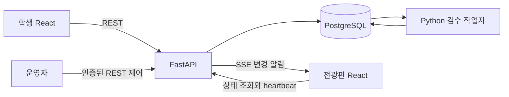

# 무드월 백엔드 설계

2026-11-04의 v2 구현은 [준비 완료 순서와 15초 재생](playback-design.md), [접수 상태와 오류](submission-status-errors.md), [연결 가이드](playback-local-implementation.md)를 따른다. API 0.8.0·migration 0006을 추가했다. 아래 즉시 말풍선·접수 기준 1시간·이모지 선택 설명은 함께 남긴 v1 호환 경로에만 적용한다.

일반 백엔드 1명과 AI 담당 1명이 React 프론트엔드 2명과 개발하는 학교 전광판 서비스입니다. 초기 범위는 학교 하나, 전광판 하나이며 익명 참여의 편의와 도배 완화를 우선합니다. 익명 브라우저 ID는 학생 한 명이나 기기 한 대를 증명하지 않습니다.

## 선택한 구조

React와 TypeScript는 화면, FastAPI는 HTTP API와 전광판 상태 관리, 독립 Python 작업자는 검수를 담당합니다. PostgreSQL이 업무 데이터와 작업의 기준 저장소입니다. Procrastinate로 검수 작업을 등록하고 실행합니다. 일반 API 프로세스는 모델을 로드하지 않습니다.



초기 실행 단위는 HTTPS 프록시, API 프로세스 1개, 검수 작업자 1개, PostgreSQL입니다. 운영 시 Linux VM과 관리형 PostgreSQL을 기준으로 하며 실제 예산에 따라 확정합니다. 전광판 노트북은 등록된 브라우저를 열어 화면을 출력합니다. 개발은 각자 로컬 환경에서 진행합니다.

전광판에 연결된 노트북은 영상 출력과 클라우드 접속을 담당합니다. 학생 휴대폰의 Wi-Fi·LTE·5G는 공개 HTTPS 주소로 접속하므로 노트북과 같은 망일 필요가 없습니다. 노트북에 백엔드·AI·DB를 함께 올리는 대안과 현장 복구 조건은 [노트북 운영](display-laptop.md)에 비교했습니다. 일반 백엔드의 코드 책임·개발 환경·검증 우선순위는 [담당자 구현 계획](backend-owner-plan.md)을 따릅니다.

**첫 단계는 챗봇 없이 독립 무드월을 개발·출시합니다.** 챗봇 모델·대화 API·UI·외부 프로그램 감지·실제 연동은 현재 출시 조건에서 제외합니다. MOODWALL·CHATBOT mode API는 향후 화면 전환용으로만 예약합니다. 별도의 강조 시간·표시 대기는 없습니다. 멘션 공개 적합성·감정 검수 모델은 챗봇과 별개로 필요합니다.

SSE는 단방향 변경 알림에 사용하며 모든 작성과 제어는 REST로 처리합니다. 재연결은 현재 상태 조회로 복원합니다. Redis, 별도 모델 HTTP 서버, 이벤트 전체 재생, Outbox, 다중 학교 구조는 초기 범위에 넣지 않습니다.

백엔드 언어가 미정인 팀이 모델 코드를 Python으로 개발하므로 Python 통일을 선택했습니다. NestJS나 Spring Boot보다 성능이 우수하다는 뜻은 아닙니다. 실제 AI 추론 지연과 메모리는 측정 후 서버 사양에 반영합니다.

언어별 선택 근거, 호출 인터페이스와 HTTP 오류·목록·snapshot 계약은 [백엔드 구현 계약](backend-contracts.md)에, 배포·측정·복구 수락 조건은 [운영 실행 기준](delivery-and-operations.md)에 구체화했습니다.

## 초기 정책

아래 숫자는 서비스 설정값입니다. 보안 표준이 요구하는 값이 아닙니다. 목표 완성일은 2026년 11월 5일이며 예산 상한은 없다고 이해했습니다. 예상 참여 인원과 실제 모델 성능은 미측정이므로 처리량과 서버 사양은 측정 후 확정합니다.

| 항목 | 결정 |
| --- | --- |
| 날짜 | 서버가 계산한 Asia/Seoul 날짜 |
| 식별 | 서버 발급 익명 세션, 초기 유지 기간 30일 |
| 작성 한도 | 학교 전체 participant 기준 최근 60분에 승인 또는 검수 중 접수 3회 |
| 시간 창 | accepted_at 기준 rolling 60분. 정각과 자정에 초기화하지 않음 |
| 검수 중 | 3회 한도에서 임시 점유, 참여자당 동시 검수 1개 |
| 신규 제출 간격 | 참여자당 10초, 같은 요청의 재전송은 제외 |
| 길이 | 앞뒤 공백 정리와 NFC 후 1~30 확장 grapheme, 서버 판정이 최종 |
| 입력 크기 | JSON 요청 본문 4 KiB 상한, 내용 자체 UTF-8 2 KiB 상한 |
| 배경 | 서버가 제공하는 emojiId 목록에서 선택 |
| QR | 5분 교체, 현재와 직전 QR 인정. 각 티켓은 발급 후 10분까지 유효 |
| 입장 허가 | 스캔한 티켓의 validUntil까지. 교환 시각부터 별도 연장하지 않음 |
| 접속망 | 학교 Wi-Fi·LTE·5G 모두 허용. 최근 QR로 참여를 제한하되 교외 차단은 보장하지 않음 |
| 금칙 패턴 | 검증된 확정 패턴만 자동 위반 집계, 3회 경고와 5회 당일 정지 |
| 모델 판정 | BLOCK 또는 UNCERTAIN은 수정 요청, 초기 자동 위반 집계 없음 |
| 처리 기한 | 접수 후 120초와 다음 한국 자정 중 빠른 시각 |
| 표시 | 승인 즉시 일반 말풍선. 강조·4개 자리·표시 대기 없음. 접수 1시간 뒤 같은 내용의 투명 말풍선으로 자정까지 유지 |
| 접속 확인 | 전광판 heartbeat 10초, 온라인 판정 유효 기간 30초 |
| 화면 최신성 | 마지막 성공 snapshot 이후 30초 미갱신이면 글·QR 가림. 숨김 탭 heartbeat 중지, 복귀 때 재동기화 |
| 말풍선 | 받은 공개 글을 접수 1시간부터 내용 담긴 투명 말풍선으로 전환. 전광판 당일 캐시에서 다음 KST 자정까지 유지 |
| 표시 용량 | 승인 글을 빈 자리 때문에 기다리게 하지 않음. 전체 페이지 수집·실제 브라우저 렌더 부하는 현장에서 측정 |
| 검수 혼잡 | 미검수 개수·실제 모델 p95로 접수 제어. 초기 상한 최대 8건, 실측 후 더 작게 설정 |
| 보관 | 서버 접수 후 1시간에 멘션 행·원문 삭제. 멱등 응답도 1시간까지만 보장, 학습 자동 편입 금지 |

사용자 선택에 따라 학교 Wi-Fi뿐 아니라 LTE·5G에서도 작성할 수 있습니다. 학교망 IP 허용 목록은 적용하지 않고 최근 QR을 요구합니다. 교외에서 아직 유효한 QR을 공유받은 사람도 입장할 수 있으므로 물리적 현장 참여나 학교 밖 차단을 보장하지 않습니다. IP와 브라우저 지문을 학생 개인이나 위치의 증명으로 사용하지 않습니다.

예를 들어 10:00에 표시한 QR A는 10:05부터 직전 QR이 되고 10:10에 만료됩니다. 10:04 입장자는 6분, 10:08에 A로 입장한 사람은 2분 남습니다. 최소 15분을 부여하는 구조가 아닙니다. 만료 시 작성 내용은 보존하고 최신 QR을 다시 스캔하게 합니다.

3회 한도는 새 의도가 접수된 시각 기준입니다. 10:00, 10:10, 10:20의 승인된 접수는 각각 11:00, 11:10, 11:20에 창에서 빠집니다. 거절·수정 요청·실패·만료는 임시 점유를 반환합니다. 승인된 글을 숨겨도 60분 안의 사용량은 유지됩니다. 일일 금칙 제재는 별도 정책으로 한국 자정에 끝납니다.

30자 판정은 브라우저 `text.length`와 SQL `char_length`로 대신하지 않습니다. 프론트의 Intl.Segmenter와 서버의 Unicode grapheme 구현을 고정하고, 한글 자모와 결합 이모지의 공통 테스트를 둡니다. 줄바꿈과 일반 제어 문자는 거절하되 이모지의 정상 결합 문자를 무조건 제거하지 않습니다.

## QR 입장

등록된 전광판만 `/api/display/qr`에서 QR 주소를 받습니다. QR은 `https://서비스주소/join#ticket=...` 형태로 고정 호스트를 사용합니다. 학생 화면은 fragment를 즉시 읽어 지우고 JSON으로 입장 API에 보냅니다. 스캔 시각을 클라이언트가 주장하더라도 서버는 입장 요청을 받은 시각을 기준으로 검증합니다.

티켓은 QR 전용 서명 문맥, 전광판, 유효 시작과 만료 시각을 포함합니다. 서명 키는 세션과 분리하고, 알 수 없는 키나 잘못된 용도는 거절합니다. 티켓은 5분 경계에 발급하며 발급 후 10분 미만까지만 교환에 쓸 수 있습니다. 현재 또는 직전 구간인지와 절대 만료를 모두 검사하고 이전 티켓을 계속 재사용해 허가를 연장하지 않습니다. 공용 QR은 여러 학생이 사용하므로 전역 일회용으로 소진하지 않습니다.

유효한 티켓이면 기존 쿠키의 참여자를 복원하거나 새 참여자를 만들고, 세션에 대상 전광판과 `admission_expires_at=ticket.validUntil`을 기록합니다. 같은 전광판의 더 최신 티켓을 먼저 교환했다면 늦게 도착한 이전 교환으로 기존의 더 긴 만료를 줄이지 않습니다. 사용자별 직전 QR 이력과 별도 입장 JWT는 필요하지 않습니다. 같은 브라우저에서 새 QR을 찍어도 참여자, 최근 60분 사용량, 당일 제재는 유지됩니다. 30일 세션은 식별용이고 짧은 입장 허가와 별개입니다.

## 제출과 검수

1. 서버 세션으로 참여자를 결정하고 기존 idempotency key를 조회합니다. 소유 세션이 유효하면 기존 결과는 입장 허가 만료나 이후 정지와 관계없이 반환합니다. 같은 키에 다른 입력이면 409입니다.
2. 새로운 요청만 입장 허가, 본문, 혼잡, 요청 간격을 검사합니다. 접속망 종류로 작성 권한을 구분하지 않습니다. 참여자 행을 잠근 뒤 같은 키를 다시 확인합니다.
3. 당일 정지와 최근 60분 한도를 검사하고 미확정 제출과 검수 작업을 같은 DB 트랜잭션에 저장합니다. 검수 동시 1개를 초과하면 409이며 한도는 소모하지 않습니다. 별도 승인·예약 카운터 대신 상태를 기준으로 사용량을 조회합니다.
4. 202와 제출 ID를 반환합니다. 프론트는 초기 1초, 이후 2초 간격으로 본인 제출을 조회하고 최종 상태에서 멈춥니다.
5. 작업자는 처리 번호를 발급받고 트랜잭션 밖에서 확정 금칙어, 유해성, 감정을 검사합니다. 자세한 입력과 출력은 [AI 계약](ai-contract.md)을 따릅니다.
6. 결과 확정 때 상태, 처리 번호, 정지, 잠금 획득 뒤 DB 시각과 접수 기한·실행 임대를 다시 검사합니다. 승인 또는 점유 해제와 위반 집계는 한 번만 반영합니다. 실행 임대 60초를 넘긴 결과는 접수 기한 120초가 남아도 승인하지 않습니다.

길이 초과, 잘못된 QR, 요청 제한, 인프라 오류는 위반이 아닙니다. 확정 금칙어 거절만 REJECTED이고, 모델 차단과 불확실은 NEEDS_REWRITE입니다. 안전성만 성공하고 감정이 실패하면 NEUTRAL과 기본 애니메이션으로 처리할 수 있습니다. 모델 점수는 실제 정확도나 제재의 확실성을 뜻하지 않습니다.

필터는 원래 NFC 표시 문장과 검색용 자모 뷰를 분리하고 검증된 유한 변형만 확정 위반으로 판단합니다. `씨%발`, `씨ㅣ바ㄹ`와 정상 포함어의 처리·사전 버전·인터페이스는 [욕설 필터 정책](profanity-policy.md)에 정의했습니다.

5번째 위반이 확정되면 같은 날짜의 미확정 제출을 취소하고 예약을 해제합니다. 이미 승인된 글의 승인 횟수는 유지합니다. 익명 쿠키를 삭제하거나 브라우저를 바꾸면 우회할 수 있으며 지문과 공용 IP로 타인의 제재를 전파하지 않습니다.

## 상태와 표시

```text
검수: PENDING → PROCESSING → APPROVED | REJECTED | NEEDS_REWRITE | FAILED | EXPIRED | CANCELLED
모델 시작 전 일시 의존성 오류 재시도: PROCESSING → PENDING → PROCESSING, 새 token
모델 시작 후 실행 유실·임대 만료: FAILED, 전체 기한 종료는 EXPIRED. 재추론 없음
서버 표시: NONE → FLOATING → EXPIRED → 접수 1시간에 행 삭제
전광판 로컬: 받은 FLOATING → 접수 1시간에 내용 담긴 AMBIENT → 다음 KST 자정 삭제
운영 숨김: 오늘의 APPROVED(이미 EXPIRED 포함) → HIDDEN, DB 행 삭제 뒤에는 원문 없는 당일 숨김 감사
화면: MOODWALL ↔ CHATBOT, 운영 중단 PAUSED
```

APPROVED는 검수 승인이고 실제 표시 완료가 아닙니다. 승인된 접수는 accepted_at 이후 60분 동안 사용량에 포함됩니다. 접수 1시간이 되면 서버가 원문 공급을 종료하므로 전광판이 그 시간 동안 오프라인이라 받지 못한 글은 표시되지 않을 수 있습니다. 이미 받은 글은 로컬 투명 말풍선으로 자정까지 남습니다. 학생 화면은 검수·서버 표시 상태와 `expiresAt`을 함께 보여 줍니다. 거절 원문과 참여자 식별자는 전광판 응답에 넣지 않습니다.

검수 작업자는 전광판 행을 잠그지 않고 APPROVED·FLOATING을 한 번 확정합니다. 승인된 글은 다음 전광판 조회에서 즉시 공급되며 빈 자리를 기다리지 않습니다. 단일 표시 조정은 약 2초마다 기한 초과·전날 공개 상태를 작은 배치로 만료 처리합니다. 조회는 정리 지연과 무관하게 오늘 날짜·접수 1시간 미만 조건을 적용합니다.

CHATBOT 또는 PAUSED에서는 화면 렌더만 중단합니다. 승인과 말풍선 페이지 동기화는 계속할 수 있으며 별도 강조 타이머나 승인 표시 대기열은 없습니다. **접수 후 1시간의 서버 DB 보관 시간은 중단·오프라인에도 흐릅니다.** mode와 운영자 display_paused를 분리하고 중단 중 API의 유효 mode는 PAUSED입니다. 전광판 기기는 운영자 중단을 해제할 수 없습니다. 받은 글은 만료 뒤에도 당일 캐시의 투명 말풍선으로 유지합니다.

장치 heartbeat·mode 변경은 전광판 행 잠금 뒤 현재 장치 hash·version·만료를 재검사합니다. 인증 직후 해지·재등록이 경합하면 옛 요청이 새 장치 상태를 바꿀 수 없습니다. 프론트도 인증 epoch·제어 경계·revision·조회 순번을 검사하는 한 경로로 snapshot을 적용하여 늦은 응답이 중단 화면을 되돌리지 않게 합니다. 자세한 알고리즘과 현장 수락은 [노트북 운영](display-laptop.md)을 따릅니다.

SSE는 변경·QR 갱신 알림만 보냅니다. 초기·재연결·알림·10초 주기마다 cursor 없는 첫 페이지부터 nextCursor=null까지 승인 말풍선을 동기화합니다. 100개는 전송 단위이며 표시 상한이 아닙니다. snapshotAt까지 승인된 글을 (finalized_at,id) 순서로 읽으며 각 페이지는 현재 숨김·TTL을 다시 검사합니다. revision이 같아도 서버 시각·글 목록이 달라질 수 있으므로 최신 응답을 적용합니다. 자정과 숨김은 서버 메타데이터로 확인합니다.

접수 1시간에는 서버 DB 원문을 삭제하고 이미 받은 글은 전광판 당일 캐시에서 내용 담긴 투명 말풍선으로 유지합니다. `ambientUntil`인 자정·명시적 숨김·기기 해지에는 캐시도 정리합니다. 화면 자리 부족으로 승인 글을 대기시키지 않습니다. 단, 전광판이 접수 1시간 전체를 오프라인으로 보낸 글은 DB 삭제 뒤 복구할 수 없고 로컬 저장소 삭제·기기 교체에도 같은 한계가 있습니다.

## 코드 책임

| 구성 | 메서드와 책임 |
| --- | --- |
| SessionService | 세션 발급과 서버 만료, 참여자 복원 |
| AdmissionService | QR 검증과 티켓 종료 시각까지의 짧은 작성 허가 |
| SubmissionService | 중복 요청 조회, 원자적 접수, 본인 상태 조회 |
| QuotaPolicy | 최근 60분 사용량 조회와 3회 제한 |
| DailyModeration | record_violation, warn, suspend, restore |
| ModerationPipeline | 사전 검사와 AI 어댑터 조합, 최종 판정 |
| FinalizeSubmission | 처리 번호와 기한을 검사하고 결과 한 번 확정 |
| DisplayCoordinator | 기한 초과·전날 상태 만료, 장치 lease와 모드 전환 |
| DisplaySnapshotService | 공개 가능한 현재 화면 생성 |
| OperatorService | 기기 등록, 숨김, 일시정지, 제재 복구와 감사 기록 |

폴더와 클래스를 나누되 별도 네트워크 서비스로 모두 분리하지 않습니다. 트랜잭션 경계와 잠금 순서는 [데이터 및 복구 설계](data-and-recovery.md)가 정의합니다.

## 최초 실행과 복원 경계

단일 운영 DB의 `BOARD_ID`를 배포 설정에 고정하고 신뢰된 CLI로 전광판·첫 ADMIN을 준비합니다. 전광판 최초 삽입에는 접수·송출 중단 true를 명시하며 pairing·heartbeat가 이를 해제하지 않습니다. 같은 초기화 재실행은 현재 상태를 덮어쓰지 않습니다. API가 임의 첫 전광판을 선택하거나 공개 요청에서 관리자·전광판을 자동 생성하지 않습니다.

백업은 격리 환경에서 복원하고 운영자·장치·pairing·worker readiness·heartbeat·QR 입장 허가를 정리한 뒤 새 worker와 재등록 장치를 확인합니다. 학생 식별 세션·사용량·제재는 원래 만료와 복구 지점의 한계를 검사합니다. 최초 CLI·배포 drain·복원 순서는 [운영 실행 기준](delivery-and-operations.md)에 있습니다.

## 공식 근거와 선택의 구분

| 기준 | 적용 |
| --- | --- |
| [OWASP ASVS](https://asvs.owasp.org/) | 권한, 세션, 입력, 운영 보안의 검증 기준. 구현의 인증이나 전체 준수 선언은 아님 |
| [OWASP API6](https://api-security.owasp.org/editions/2023/en/0xa6-unrestricted-access-to-sensitive-business-flows/) | 게시와 익명 세션 생성의 도배 및 자원 남용 제한 |
| [FastAPI SSE](https://fastapi.tiangolo.com/tutorial/server-sent-events/) | 단방향 변경 알림, 실제 복원은 현재 상태 조회 |
| [Procrastinate 외부 연결](https://procrastinate.readthedocs.io/en/stable/howto/production/external_connection.html) | 업무 데이터와 작업 등록의 원자성 |
| [OpenAPI 3.1](https://spec.openapis.org/oas/v3.1.1.html) | 언어 중립 HTTP 계약. 구현 시 계약과 실제 응답 일치 검사 |

프레임워크 선택, QR 시간, 시간당 작성 한도, 일일 제재 횟수, 보관 기간은 이 프로젝트의 결정입니다. 실제 검증 항목과 미검증 상태는 [검증 기준](verification.md)에 기록합니다.
