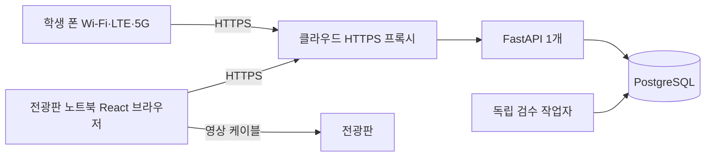

# 일반 백엔드 담당자의 구현 계획

기준일: 2026-10-29. 일반 백엔드 1명·AI 1명·프론트 2명, 11월 5일 목표를 기준으로 한다. 사용자가 전광판에 연결할 노트북을 보유한다는 조건을 포함한다. 이 문서는 구현 책임과 선택을 구체화한 것이며 앱·배포가 이미 구현되었다는 뜻은 아니다.

## 1. 현재 권고와 이유

**FastAPI 한 프로젝트 + 독립 Python 검수 작업자 + PostgreSQL을 유지하고, 전광판 노트북은 브라우저로 화면을 출력한다.** API·작업자·HTTPS 프록시는 초기 Linux VM 한 대 안에서 별도 프로세스·컨테이너로 운영할 수 있다. 관리형 DB는 별도 보관한다. 기능마다 물리 서버 한 대씩 필요한 구조가 아니다.

네가 만드는 부분은 API·업무 정책·DB·큐 연결·작업 감시·전광판 상태·최소 운영 기능이다. AI 담당은 호출 가능한 추론 모듈과 모델·평가를 제공한다. 프론트는 화면·재연결·애니메이션을 구현한다. 실제 노트북 전원·케이블·절전 설정은 현장 운영 항목이며, backend heartbeat만으로 실제 패널 점등을 증명하지 않는다. [노트북 배치와 현장 기준](display-laptop.md)

**첫 구현과 출시는 챗봇 없는 독립 무드월이다.** 챗봇 UI·대화 모델·대화 API·외부 프로그램 감지·실제 연결은 현재 네 범위나 독립 무드월 출시 조건이 아니다. 기존 mode API·CHATBOT enum의 렌더 전환 계약만 예약하고 API 시험으로 확인한다. 실제 UI 없이 개발 도구로 계약을 시험해도 된다. 멘션 검수 AI는 별개로 기존 연결·평가 조건을 유지한다.

## 2. 실무 관행과 현재 선택 비교

| 항목 | 비교할 실무 기준 | 이 프로젝트의 선택·조건 |
| --- | --- | --- |
| 서비스 분리 | 배포·장애·개발 책임이 실제로 다른 경계로 분리 | 한 백엔드 프로젝트에서 모듈 분리. API와 CPU 모델 실행만 프로세스 격리 |
| 언어 | 팀 숙련도·기존 코드·운영 부담을 기준으로 선택 | Python 통일. NestJS·Spring도 가능하나 지금은 두 언어 운영의 이득이 확인되지 않음 |
| 저장 | 업무 상태와 제약을 한 저장소에서 일관되게 유지 | PostgreSQL을 원본으로 사용. Redis 추가는 측정된 필요가 생기면 검토 |
| 데이터 접근 | ORM 또는 SQL 어느 쪽이든 트랜잭션·파라미터·migration 검증 | 업무 쿼리는 psycopg 3로 고정. Procrastinate에 같은 연결을 전달하는 경로부터 시험 |
| 작업 큐 | 영속 접수·중복 방어·실패 복구·CPU 격리 | Procrastinate 유지. 강제 종료 supervisor는 별도 구현·검증해야 하는 큰 과제 |
| 실시간 | 재연결 뒤 올바른 현재 상태로 복구 | snapshot polling으로 먼저 연결하고 SSE 알림 추가. 최종 계약은 SSE+10초 조회 |
| 보안 | 서버 권한·입력·세션·제재를 일관되게 검사 | 역할별 쿠키·CSRF·QR 만료·원자적 한도·최소 운영 권한 |
| 배포 | 재현 가능한 버전·DB 변경·복구·관측 | 수동 검증 배포부터 시작. 이미지·모델·schema 버전을 기록 |

이 표의 프레임워크·DB·SSE 선택은 업계의 유일한 표준이 아니다. 표준화된 HTTP 계약, 검증 가능한 트랜잭션, 권한·복구 원칙을 팀에 맞게 적용한 설계다. [상세 계약과 근거](backend-contracts.md)

## 3. 네가 구현할 작업 단위

각 행은 유스케이스 단위다. 클래스 이름은 책임을 설명하는 기준이며 모든 메서드에 추상 계층을 추가하라는 뜻은 아니다.

| 작업 | 중요한 구성과 메서드 예시 | 관련 API | 완료 증거 |
| --- | --- | --- | --- |
| 익명 식별·입장 | SessionService의 resolve, AdmissionService의 verify/exchange | `/api/admissions/exchange`, `/api/session` | 같은 브라우저 재입장 유지, 현재·직전 QR의 절대 10분 만료, CSRF·stale 쿠키 처리 |
| 제출·작성 한도 | SubmissionService.submit, QuotaPolicy.evaluate | `/api/submissions`, `/api/me/usage`, 본인 제출 조회 | 최근 60분 3회·동시 검수1·10초 간격, 같은 키 제출·job 하나, DB 잠금 경합 시험 |
| 글 검증·욕설 규칙 | TextPolicy.validate, ProfanityFilter.scan | 접수 검증·검수 내부 | 30 grapheme·크기·이모지 허용 목록, 확정 패턴과 정상 포함어의 공통 fixture |
| AI 호출·결과 확정 | ModerationPipeline.run, FinalizeSubmission.finalize | 내부 작업자, 학생은 상태 GET | AI 모듈 호출, 결과 구조·token·기한·lease 확인, 게시·위반 한 번 반영 |
| 작업 복구 | ModelSupervisor, ExpiryMaintenance | worker와 API 제어 루프 | 멈춘 native 실행이 실제 종료되고 다음 정상 요청이 처리됨. DB 점유 반환은 독립 실행 |
| 전광판 연결 | DevicePairingService.pair/revoke | `/api/display/pair`, `/api/display/session` | 실제 노트북 쿠키 발급·재사용, 교체된 장치 거절, 열린 SSE 해지 |
| 전광판 상태 | DisplayCoordinator.reconcile/heartbeat/set_mode, DisplaySnapshotService.get | `/api/display/state`, `/api/display/events`, `/api/display/heartbeat`, `/api/display/mode` | 승인 즉시 일반 말풍선·100개 전송 페이지·서버 원문 1시간/로컬 말풍선 자정·removedIds/reset token/기기 세대·예약 mode·전체 페이지·재접속·늦은 응답 무효화 |
| 최소 운영 기능 | OperatorService.hide/pause/restore | `/api/operator/*` | 개인별 로그인·권한, 글 숨김·접수/송출 중단·당일 제재 복구와 감사 기록 |
| 배포·DB 변경 | RuntimeLifecycle, BootstrapCommands, migration·release 절차 | health와 신뢰된 CLI | BOARD_ID·첫 ADMIN·중단 상태 초기화, 빈 DB·upgrade, 기존 job drain·버전 고정, 격리 복원, 실제 휴대폰→노트북 표시 |

작성·애니메이션·관리 화면의 React 구현은 프론트가 맡고, 네가 API와 권한·상태 계약을 제공한다. AI의 BLOCK/UNCERTAIN을 서버가 NEEDS_REWRITE로 변환하며 AI 판단만으로 경고·정지를 누적하지 않는다. 사전·제재 규칙은 네 책임이다. [AI 요청서](ai-team-request.md), [욕설 필터 구현 정책](profanity-policy.md)

## 4. 가장 먼저 증명할 세 가지

### A. 제출과 job의 원자성

실제 PostgreSQL·고정한 Procrastinate 버전에서 테스트한다. 제출 INSERT 뒤 job defer에 의도적 오류를 내면 **둘 다 없어야 한다**. 반대로 둘 다 commit한 뒤 응답을 끊고 같은 키를 보내면 원래 제출·job·한도가 한 번만 존재해야 한다. 현재 DDL 제약 검사만으로 이 사실이 입증된 것은 아니다.

Procrastinate는 psycopg의 외부 연결을 받아 그 트랜잭션에 job을 등록하는 공식 경로를 제공한다. API 저장소와 enqueue가 다른 연결에서 각각 commit하는 구현을 피한다. SQLAlchemy AsyncSession·asyncpg로 예제를 교체할 때 이 보장이 그대로 남는다고 추정하지 않는다. [외부 연결 공식 예시](https://procrastinate.readthedocs.io/en/stable/howto/production/external_connection.html)

### B. 모델 hang 뒤 실제 회복

취소를 따르지 않는 동기 fixture로 worker를 멈춘다. supervisor의 TERM·KILL·종료 수거, readiness 해제, FAILED/EXPIRED·점유 반환, 늦은 결과 무시를 확인하고 **다음 정상 제출이 검수되는 것**까지 증명한다. 단순 `asyncio.sleep`의 취소만 확인하지 않는다.

이 부분이 현재 설계에서 가장 어려운 운영 코드다. Procrastinate는 강제 종료를 직접 제공하지 않고 process manager의 책임으로 둔다. [종료 문서](https://procrastinate.readthedocs.io/en/stable/howto/advanced/shutdown.html)

| 큐 선택 | 얻는 것 | 감당할 것 |
| --- | --- | --- |
| 현재 Procrastinate | PostgreSQL과 같은 트랜잭션의 접수·job, 별도 broker 생략 | custom supervisor·실행 임대·stalled 관리 검증 |
| Celery Linux prefork 대안 | hard time limit에서 실행 자식 종료·교체 기능 | Redis/RabbitMQ 등 broker, DB commit↔publish 실패 간격·중복·재전달 보완 |

Celery도 exactly-once·올바른 제재를 자동 보장하지 않는다. gevent 등 pool마다 time limit 제약도 다르다. 지금 큐를 교체한 것은 아니며, 초기 supervisor 검증이 어려울 경우 비교할 대안이다. 직접 코드의 양과 운영 서비스 수를 함께 계산한다. [Celery time limit](https://docs.celeryq.dev/en/stable/userguide/workers.html#time-limits), [broker 선택](https://docs.celeryq.dev/en/stable/getting-started/first-steps-with-celery.html#choosing-a-broker)

### C. 실제 노트북 단절·복귀

노트북은 학교망, 휴대폰은 LTE·5G에서 QR→접수→검수→표시를 확인한다. 이후 탭 숨김·예약 mode API·10분 단절·자정을 시험한다. 서버 시간 정산은 이전 lease를 먼저 적용하고, 프론트는 복귀 때 최신 snapshot을 읽어 이전 날짜 글·만료 QR을 가린다. 노트북 재부팅과 쿠키 유지도 확인한다. 지연한 GET 뒤 PAUSED·장치 해지, 옛 heartbeat 뒤 재등록을 삽입해 권한·화면이 되돌아가지 않는지도 시험한다. [현장 시험](display-laptop.md)

## 5. 데이터 접근·migration·개발 환경 고정

- 업무 SQL은 고정 문자열과 파라미터 바인딩으로 작성한다. 사용자 값·cursor·정렬 키를 SQL 문자열에 직접 이어 붙이지 않는다. 전체 저장소에 공유하는 글로벌 연결 하나 대신 요청·업무 트랜잭션마다 풀에서 빌린다. 같은 요청 안의 저장과 enqueue만 같은 연결을 공유한다. [Psycopg 파라미터](https://www.psycopg.org/psycopg3/docs/basic/params.html)
- ORM을 쓰지 않는 것이 표준이라는 뜻은 아니다. 현재 잠금과 큐 연결 경로를 명시적으로 이해하기 위해 psycopg 3로 통일한다. SQLAlchemy ORM을 추가하려면 같은 연결·rollback·잠금 시험부터 한다.
- 앱 schema 변경 도구는 **Alembic**을 기준으로 고정한다. migration에서 SQLAlchemy를 사용할 수 있지만 업무 쿼리를 ORM으로 옮기지는 않는다. 초기 DDL을 첫 revision으로 옮기고 이후 변경은 새 revision으로 추가한다. SQLAlchemy는 migration 실행 의존성으로 역할을 구분한다. [Alembic tutorial](https://alembic.sqlalchemy.org/en/latest/tutorial.html), [SQL 실행 연산](https://alembic.sqlalchemy.org/en/latest/ops.html#alembic.operations.Operations.execute)
- Alembic이 트랜잭션을 관리하도록 `schema.sql`의 바깥 BEGIN/COMMIT을 그대로 중첩 실행하지 않는다. 초기 revision의 빈 DB 생성과 다음 revision의 upgrade를 실제 PG로 확인한다. Procrastinate의 schema revision은 별도 공식 migration으로 관리한다. 배포 한 곳에서만 순서대로 실행한다.
- Windows 작업 환경에서도 API·worker·개발 DB는 Linux Docker 환경으로 맞춘다. psycopg async는 Windows 기본 Proactor loop에 호환 조건이 있으므로 처음부터 운영과 같은 OS 경로를 검증한다. 전광판 노트북은 브라우저만 실행해 이 Python 조건과 분리된다. [Psycopg async·Windows 주의](https://www.psycopg.org/psycopg3/docs/advanced/async.html#asynchronous-operations)
- API는 await 가능한 DB I/O를 async로 처리하고 CPU 모델은 별도 프로세스에 둔다. async 함수로 감싼 것만으로 CPU 실행이 분리되거나 강제 종료되는 것은 아니다. FastAPI BackgroundTasks로 영속 검수 큐를 대체하지 않는다. [FastAPI CPU 작업 안내](https://fastapi.tiangolo.com/tutorial/background-tasks/)
- 프론트는 OpenAPI mock으로 병행 개발하고, 로컬 통합 때 `/api` dev proxy로 요청 출처를 정리한다. 실제 휴대폰과 연결하는 시험은 공개 staging HTTPS 주소와 운영 쿠키 정책으로 별도 확인한다. 개발용 HTTP 예외를 운영에 배포하지 않는다.

## 6. API 제어 루프의 소유권

초기 API 실행은 **프로세스 1개, workers=1**로 고정한다. FastAPI lifespan이 DB 풀과 표시 2초·만료 5초·stalled 관리 10초 루프를 한 번 시작하고, 종료 때 루프 중단·취소·await 후 풀을 닫는다. 요청 라우터가 루프를 새로 만들거나 startup마다 migration을 실행하지 않는다. [FastAPI lifespan](https://fastapi.tiangolo.com/advanced/events/), [worker 프로세스](https://fastapi.tiangolo.com/deployment/server-workers/)

각 루프는 성공 시각·현재 실패 원인을 가진다. 예상 가능한 DB 장애는 안전한 오류 기록 후 다음 주기에서 재시도하고, 성공으로 기록하지 않는다. 예상하지 못한 루프 종료를 방치하지 않고 API ready 실패·새 접수 중단·경보로 전환하고 운영자가 API 재시작 절차를 실행한다. 프로세스 자체가 종료되면 restart policy를 적용한다. unhealthy 표시만으로 Docker가 자동 재시작한다고 가정하지 않으며 단순 DB 장애만으로 API를 무한 재시작하지 않는다.

표시 루프 10초·만료 루프 15초 이상 성공 없음은 기존 ready 실패 기준이다. 이 상태에서는 신규 접수를 일시 거절하고 조회·운영 복구는 가능한 범위에서 유지한다. lifespan 시작·종료·루프 예외·중복 시작 방지를 실제 시험한다. 초기에는 process 수만 늘려 처리량을 높이지 않는다. 다중 API를 도입할 때는 루프 소유권과 메모리 SSE 알림 공유를 함께 설계한다.

모델 준비·실행 감시는 별도 worker supervisor가 맡고 API lifespan에 모델을 로드하지 않는다. 모델 코드를 import했다는 이유만으로 API에서 가중치를 로드하지 않도록 어댑터 초기화를 작업자 bootstrap에 둔다. 프로세스 간 psycopg 연결도 공유하지 않는다.

## 7. 구현 순서와 PR의 완료 기준

먼저 위 세 검증의 위험을 확인하고, 아래 범위마다 리뷰 가능한 크기로 PR을 자른다. 큰 단계는 여러 PR로 나눌 수 있다. 기존 날짜별 목표는 [협업 계획](implementation-plan.md)을 따르며, 검증 시간이 사라지는 완료 약속으로 해석하지 않는다.

| 순서 | PR 범위 | 이 단계가 끝났다고 판단할 결과 |
| --- | --- | --- |
| 1 | Linux 환경·버전 고정·앱/큐 migration·fake worker·원자성 실험 | 빈 DB부터 재현, job 등록 오류에서 전부 rollback |
| 2 | worker 감독·준비 상태·실행/전체 기한·실패 복구 | hang fixture 뒤 실제 종료, 점유 반환, 다음 정상 검수 |
| 3 | 세션·QR·입력 검증·제출·rolling 한도·기본 필터 | 같은 키 재전송·동시 접수·QR 경계·정상 포함어 시험 통과 |
| 4 | 장치 pairing·snapshot·heartbeat·예약 mode·최소 운영 숨김/중단 | 전체 페이지 수집, 단절·구 장치 해지 경합, 늦은 GET 무효화, 실제 노트북 표시 |
| 5 | 실제 AI 모듈 연결·평가·SSE·전광판 회귀 | 실제 모델 결과와 실패 동작, 원문 비노출, 화면 상태 일치 |
| 6 | HTTPS 배포·로그·보관 정리·백업 복원·현장 수락 | 같은 release로 휴대폰부터 전광판까지 확인, 복원 기록 확보 |

operator 권한 검사는 운영 API를 처음 만드는 단계부터 넣는다. 숨김·중단을 뒤늦게 보안 없이 임시 공개하지 않는다. 전용 시험 데이터와 fake는 개발 단계에서만 사용하고 실제 학생 공개 전에 실제 검수·복구·운영 수락을 통과한다.

PR 1에 신뢰된 `init-board`·`create-operator` CLI 계약을 포함한다. BOARD_ID가 없는 API 시작은 ready 실패로 처리하고, 최초 board는 명시적으로 접수·송출을 중단한다. 초기화 재실행은 기존 자격·mode를 바꾸지 않으며 ADMIN이 확인 후 각각 재개한다. 배포에서는 기존 비최종 제출을 구 버전에서 drain하거나 제재 없이 terminal화한 뒤 새 worker를 시작한다. 복원에서는 임시 권한·readiness·lease·입장 허가를 지우고 재등록 후 재개한다. 상세 실행 순서와 최초 smoke의 짧은 접수 재개는 [운영 기준](delivery-and-operations.md)을 따른다.

## 8. 범위를 늘리지 않을 항목

기능별 마이크로서비스, Redis 캐시, 다중 학교, API 여러 복제, 고급 관리자 통계, 모든 테이블의 추상 Repository, 자동 재학습, 완전 자동 배포, 실제 챗봇 UI·대화 모델·연동을 처음부터 추가하지 않는다. 권한·중복 방어·트랜잭션·검수 전 비공개·실행 종료·숨김·복구는 첫 운영의 필수다.

실제 구현·성능·큐 연결·Alembic migration·노트북 설정은 아직 미검증이다. 기존 검사 결과는 [검증 기록](verification.md)의 범위를 따르고, 이번 문서의 추가 수락 항목은 앞으로 실행할 시험이다.
