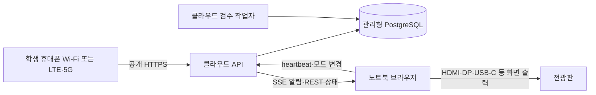

# 전광판 노트북의 역할과 현장 운영

2026-11-09: 도서관 LED(2046×768) 한 대 구성은 **노트북이 서버까지 맡는 방식**으로 정리했다. [도서관 노트북 운영](library-laptop-operation.md)을 우선한다. 아래 클라우드 권고는 여러 전광판이나 상시 운영으로 확장할 때의 기준이다.

2026-11-05 구현: 공개 `/display`의 오류 안내·자동 등록 폼을 기본 배경으로 대체하고 직원 설정을 `/display/setup`으로 분리했다. 공개 런처의 오류 팝업도 제거했다. [현재 복구 구현과 검증 범위](display-recovery-implementation.md), [설계와 보존 기준](display-recovery-design.md)을 따른다. 아래 v1 설명의 공개 연결 안내·접수 시점 기준 보관은 현행 v2 동작에 적용하지 않는다.

현재 v2 전광판 React 화면은 [준비 완료 순서와 15초 재생](playback-design.md), [접수와 제어 오류](submission-status-errors.md)를 연결했다. 단일 재생 주체·고정된 시작 승인 기한·완료 보고·중단 복구를 제공한다. [실제 화면 실행](../frontend/README.md)과 [모듈 연결법](../clients/display/README.md)을 따르며, 아래 즉시 말풍선·접수 기준 1시간은 이전 v1 운영 설명이다.

갱신일: 2026-11-04. 전광판에 연결할 Windows 노트북이 있다는 사용자 설명을 반영한다. CPU/GPU·메모리·학교 외부 인터넷 정책과 실제 서비스 웹주소는 아직 확인하지 않았다. 이 문서는 배치 결정과 현장 검증 기준이며, 실제 노트북 설정이나 배포를 실행했다는 뜻이 아니다.

## 확정한 화면 운영 시간

2026-11-04 사용자 운영 조건: 전광판은 매일 **한국 시간 06:00부터 23:00까지** 켠다. 시간 범위는 06:00 포함, 23:00 제외로 해석한다. 이는 전광판 화면의 운영 일정이며, 화면 전원만 끄는 것과 노트북 브라우저·API·DB를 종료하는 것은 구분한다. 패널만 꺼지고 노트북 브라우저의 heartbeat가 계속되면 서버는 장치가 연결되어 있다고 판단할 수 있다.

사용자 선택은 **전광판만 끄고, 접수 정책은 별도로 결정**하는 것이다. 23시가 되었다는 이유로 새 자동 접수 차단을 추가하지 않는다. 현재 코드에는 이 시간대의 자동 접수·재생 중단이 구현되어 있지 않다. 기존 QR 입장·최근 60분 한도·장치 온라인 판정은 계속 적용하므로, 이 선택이 운영 시간 밖의 접수를 항상 허용한다는 뜻은 아니다. 특히 노트북 브라우저까지 종료하면 기존 온라인 허가가 만료된 후 새 v2 접수는 `DISPLAY_OFFLINE`으로 거절된다.

패널만 끄고 브라우저 재생을 계속하면 서버의 재생 완료와 실제 패널에서 보였는지가 다를 수 있다. 23시 종료 직전의 15초 완주, 소프트웨어 송출 중단과 접수·대기열 마감의 연계는 후속 결정 사항이다. 현재 대기 기한을 늘려 다음 날까지 글을 이월하거나 화면 밖 재생을 실제 관람으로 보장하지 않는다.

화면 운영 시간과 데이터 보관은 별도다. 기존 v2 원문은 최초 표시 시작 승인 +1시간, 받은 말풍선의 당일 캐시는 KST 자정까지라는 정책을 유지한다. 브라우저가 밤에 꺼져 자정 정리를 실행하지 못해도 다음 날 시작 시 전날 캐시를 먼저 지운다. 이 문서 기록은 실제 장치 전원 예약이나 운영 시간 제한을 적용했다는 뜻이 아니다.

## 1. 권고 배치

**클라우드에서 API·검수 작업자를 실행하고, 관리형 PostgreSQL에 저장하며, 노트북은 전광판 브라우저를 실행한다.** 노트북이 있다는 사실만으로 그 기기를 공개 서버로 사용할 이유가 생기지는 않는다. 이 선택은 소규모 팀의 운영 책임을 줄이려는 프로젝트 판단이며, 특정 배치가 업계의 유일한 표준이라는 뜻은 아니다.

화면 케이블은 노트북 영상을 전광판으로 보내고, Wi-Fi·유선 인터넷은 노트북과 서버를 연결한다. 두 연결은 서로 다른 점검 항목이다. 학생 휴대폰과 노트북은 같은 Wi-Fi에 있을 필요가 없다. 학생 QR에는 실제 서비스의 공개 HTTPS 도메인을 넣는다. `localhost`·`127.0.0.1`은 스캔한 휴대폰 자신을 가리키고, 교내 사설 IP만으로는 LTE·5G 참여를 제공할 수 없다.

| 배치 | 이점 | 운영 부담·실패 영향 | 선택 조건 |
| --- | --- | --- | --- |
| **클라우드 API+작업자+관리형 DB / 노트북 브라우저** | 화면 기기와 서비스 생명주기를 분리, 원격 배포·백업 가능 | 서버 비용, 인터넷 의존, 초기 단일 VM 장애 시 서비스 중단 | 현재 권고. 실제 모델 CPU 처리 시간·메모리로 서버 사양 결정 |
| 노트북에 API+AI+DB 모두 배치 | 한 기기에서 시연하기 쉽고 보유 장비 활용 | 전원·절전·재부팅·화면 부하가 서비스와 DB에도 영향. LTE 접속에는 공개 HTTPS 진입점·학교 승인 네트워크 설계·외부 백업 필요 | 로컬 개발·제한된 시연 우선. 운영 전 전용 호스트 수준의 유지관리와 접근 경로 검증 필요 |
| 클라우드 API+DB / 노트북 AI 작업자 | 실제로 적합한 GPU가 있는 경우 AI 계산 활용 가능 | 화면 기기 종료 때 신규 검수 중단, 인터넷·모델 배포·비밀값 관리 경계 추가 | 클라우드 CPU 실측이 목표 미달이고, 노트북 성능·항시 전원·망·관리 책임이 확인될 때 재검토 |

혼합 배치는 현재 DB 기반 큐에 노트북을 단순 연결하는 것으로 채택하지 않는다. 작업자 인증·허용 통신·결과 검증·재시도·기한 감시를 다시 설계해야 한다. DB를 인터넷 전체에 공개하거나 학교 보안 정책을 우회해서 해결하지 않는다. 학교가 외부 HTTPS·장기 응답 연결을 제한하면 담당 관리자와 허용 가능 경로를 확인한다. SSE가 제한되고 REST가 허용되는 경우에는 기존 10초 snapshot polling으로 성능을 별도 측정한다.

## 2. 노트북에 둘 것과 서버에 둘 것

| 위치 | 책임 |
| --- | --- |
| 노트북 브라우저 | 무드월 렌더·애니메이션, 장치 쿠키 보관, SSE·snapshot 동기화, heartbeat, 받은 공개 카드의 당일 캐시·투명 말풍선, 연결 이상 안내. 실제 챗봇 UI는 후속 범위 |
| 서버 | QR 서명·만료, 학생 세션·최근60분 제한, 금칙어·AI 확정, 승인 말풍선 페이지, 장치·운영 권한·숨김·자정 |
| 관리형 DB | 업무 상태·작업·감사 기록, 백업과 복원에 필요한 데이터 |

권고 구성에서는 노트북에 Node 개발 서버·Python API·DB·모델을 설치하지 않는다. React는 서버가 제공하는 빌드 결과를 브라우저가 읽는다. DB 비밀번호·QR 서명 키·AI 배포 자격을 노트북이나 React 번들에 넣지 않는다. 장치 HttpOnly 쿠키도 권한 있는 비밀이므로 전용 프로필 접근과 기기 해지 절차를 유지한다. 노트북에는 운영자 로그인 상태를 상시 남기지 않는다.

## 3. 시작·연결 복구 순서

1. 현장 관리자가 전원·화면 출력·인터넷을 확인하고 전용 브라우저 프로필에서 서비스 전광판 경로를 연다.
2. 미등록·만료·해지 장치라면 운영자가 별도 화면에서 5분 유효 일회용 pairing code를 발급하고 노트북에서 입력한다. 서버가 장치 쿠키를 발급한다. 일반 새로고침 때 매번 코드를 요구하지 않는다.
3. 장치 세션·CSRF를 확인하고 최신 `/api/display/state`와 `/api/display/qr`를 읽은 뒤 동기화된 화면을 보여 준다. 장치 초기화만으로 학생 ID나 작성 한도를 바꾸지 않는다.
4. 단일 SSE 연결과 10초 state polling, 10초 POST heartbeat를 시작한다. SSE `open` 때도 state와 QR을 다시 읽는다. SSE는 단방향 알림이므로 작성·heartbeat·모드 변경은 REST를 쓴다. [MDN EventSource](https://developer.mozilla.org/en-US/docs/Web/API/EventSource)
5. 끊어진 EventSource는 기본 재연결을 활용하고 별도 연결을 중복 생성하지 않는다. `error`만으로 장치 해지를 단정하지 말고 세션 조회로 구분한다. 해지·만료가 확인되면 EventSource를 닫고 보호 화면으로 전환한다. [MDN 재연결·종료](https://developer.mozilla.org/en-US/docs/Web/API/Server-sent_events/Using_server-sent_events)
6. 재연결·절전 복귀 때 session과 새 첫 페이지로 인증·숨김·날짜·기기 세대를 확인한 뒤 당일 캐시를 합치고 QR을 갱신한다. nextCursor=null까지 모든 페이지를 순차 수집한다. 같은 revision의 최신 응답도 적용하며 역순 응답은 아래 단일 적용 규칙으로 제외한다.

승인된 글은 즉시 일반 떠다니는 말풍선으로 표시한다. 4개 자리 제한·강조·표시 대기는 없다. 접수 1시간부터 이미 받은 글을 **내용이 담긴 투명 말풍선으로 자정까지 유지**한다. DB는 접수 1시간에 삭제하지만 브라우저 당일 캐시는 별도다. 중단·오프라인으로 DB 보관 시각을 늦추지 않는다. heartbeat는 30초 온라인 lease 확인용이며 별도 강조 타이머는 없다. heartbeat 성공이 케이블·전광판 전원·실제 시청을 증명하지는 않는다.

장치의 heartbeat·mode 변경은 인증 의존성의 최초 검사만으로 끝내지 않는다. 서버가 전광판 행 잠금을 얻은 뒤 현재 token hash·version·만료를 다시 확인한다. 잠금 대기 중 장치가 해지·교체됐다면 옛 요청은 실패하고 새 장치의 lease·mode를 변경하지 않는다.

### 늦은 응답과 말풍선 페이지

브라우저의 화면 상태를 바꾸는 함수는 하나로 모은다. 해당 장치 인증 수명인 `authEpoch`, 로컬 제어 경계인 `controlSeq`, 조회 요청 순번을 각 요청에 붙여 관리한다. 인증 해지·재페어링·절전이나 hidden 후 복귀의 재검증을 시작하면 epoch를 바꾸고 이전 요청·SSE를 정리한다. 새 epoch의 세션·state·QR 확인 전에는 보호 화면을 유지한다.

- 응답의 epoch·제어 경계·board가 현재와 같아야 한다. 낮은 revision·오래된 요청 순번은 버리고 같은 revision의 최신 응답은 서버 시각·글·숨김을 포함해 적용한다. 페이지마다 snapshotAt은 첫 페이지와 같아야 하며 revision/serverNow는 최신값으로 증가할 수 있다.
- 로컬 mode 제어를 시작할 때 `controlSeq`를 올려 이전 GET을 무효화한다. POST가 반환한 `DisplayState`를 다른 경로에서 직접 렌더하지 않고 성공 후 새 GET으로 확인한다. 실패·응답 유실 때도 이전 GET을 부활시키지 않고 현재 상태를 다시 조회한다. 제어 요청은 중첩하지 않는다.
- SSE·제어 성공에서 더 높은 revision을 알게 되면 그보다 낮은 snapshot을 적용하지 않고 새 조회를 요청한다. 이벤트 자체에는 글이나 명령을 넣지 않으며 현재 state를 다시 읽는 신호로만 쓴다.
- 401 또는 장치 해지가 확인되면 epoch를 즉시 바꾸고 글·QR을 지운다. 이미 실행 중이던 옛 GET의 성공 응답으로 보호 화면을 해제하지 않는다. `AbortController`는 요청 정리에 사용하되 최종 적용 검사도 유지한다. [MDN AbortController](https://developer.mozilla.org/en-US/docs/Web/API/AbortController/abort)

`bubbles`를 안정된 ID로 합쳐 일반 말풍선으로 렌더한다. 고정 slot·remainingMs는 없다. 같은 ID를 다시 받았다고 입장 애니메이션을 재시작하지 않는다. expiresAt부터 이미 받은 내용은 AMBIENT로 전환한다. 100개는 전송 페이지 크기이며 표시 상한이 아니다. `DisplaySynchronizer`로 매 poll 첫 페이지부터 nextCursor=null까지 수집하고 422 INVALID_CURSOR는 1회 첫 페이지 재시작한다. 이전 인증 epoch의 성공·실패는 현재 화면을 바꾸지 않는다. 서버 ID 부재로 캐시를 삭제하지 않는다.

카드·state의 ambientUntil은 다음 KST 자정이다. 캐시는 board·deviceGeneration·업무 날짜에 묶고 removedIds는 원문과 함께 지운다. cacheResetToken 변경은 당일 캐시 초기화 후 현재 허용 카드만 합치는 경계다. 받은 당일 카드를 ID로 합쳐 보관한다. 2026-11-09부터 화면에서 움직이는 구름은 최신 30개(`MAX_DRIFTING_CLOUDS`)만 렌더하고 개수·예보는 전체로 계산한다. 2046×768 LED에서 그 이상은 읽을 수 없고 GPU 부담만 커진다. `bubbleTotalCount`는 아직 DB에 남은 수로 로컬 전체와 다르다.

[캐시 모듈](../clients/display/bubble-cache.mjs)의 기본 당일 보관 상한 2000개(설정 최대 10000개)는 메모리 보호용이며 제품의 4개 표시 제한이 아니다. 초과 시 오래된 카드부터 제거한다. localStorage 제한·프로필 삭제·강제 종료의 복구 한계를 실제 노트북에서 확인한다. view는 `{visible,bubbles,totalCount}`이고 phase는 FLOATING/AMBIENT다. 독립 모듈은 완성된 React 화면·실제 브라우저 통합 검증을 뜻하지 않는다.

같은 프로필의 여러 탭은 장치 쿠키를 공유한다. 단일 활성 장치 자격이 단일 실행 탭까지 보장하지는 않으므로 초기 현장 운영은 전광판 탭 하나로 제한한다. 중복 탭 방지가 필요하면 same-origin Web Locks로 연결·heartbeat 소유자를 하나로 정할 수 있지만, 이것을 서버 인증이나 보안 경계로 사용하지 않는다. [MDN Web Locks](https://developer.mozilla.org/en-US/docs/Web/API/Web_Locks_API)

## 4. 독립 무드월과 향후 챗봇 전환

**첫 개발·출시는 챗봇 없는 독립 무드월이다.** 챗봇 모델·대화 API·화면·외부 감지·실제 연결은 현재 출시 gate가 아니다. CHATBOT과 mode API는 향후 렌더 전환용으로만 예약하며 강조 시간·표시 대기는 없다. 멘션 검수 AI는 별개로 필요하다.

향후 같은 웹앱에서 연결하면 mode API 성공 후 해당 보기를 표시한다. CHATBOT 동안에도 승인·말풍선 동기화는 계속하며 일반 렌더만 멈춘다. 운영 PAUSED는 기기가 해제할 수 없고409 BOARD_PAUSED를 따른다.

외부 웹 챗봇·별도 브라우저·다른 프로그램을 쓰면 누가 시작·종료를 알리고 무드월을 다시 여는지 통합 계약이 필요하다. 다른 앱을 켜기만 하면 서버는 CHATBOT 전환을 알 수 없다. CSS로 무드월 컴포넌트를 숨겨도 Page Visibility 이벤트가 자동 발생하지 않으므로 그 연동은 mode API를 명시적으로 호출해야 한다. [MDN 문서·iframe 가시성](https://developer.mozilla.org/en-US/docs/Web/API/Page_Visibility_API)

연동을 확정할 때 실행 형태, 전환을 요청할 주체, 시작·종료·비정상 종료 신호, 무드월 복귀 책임을 함께 정한다. 그전까지는 외부 프로그램의 자동 감지·복귀가 구현되었다고 가정하지 않는다. 등록 장치의 기존 인증·Origin·CSRF 계약은 유지한다.

문서 hidden이면 heartbeat·애니메이션을 멈추고 visible 복귀에 session·state·QR을 다시 맞춘다. 타이머 실행 횟수로 접수 1시간·QR·자정을 판정하지 않는다. [MDN 타이머 제한](https://developer.mozilla.org/en-US/docs/Web/API/Page_Visibility_API)

## 5. 오프라인·자정·오래된 화면

연결 상태와 콘텐츠의 최신성은 구분한다. SSE만 끊겨도 REST polling이 성공하면 최신 화면을 유지할 수 있다. `navigator.onLine` 값만으로 서버 연결 성공을 판정하지 않는다.

- 현재 v2에서는 동기화 실패·온라인 허가 만료 때 캐시의 공개 표시 규칙을 적용하고, 표시할 수 없는 영역은 기본 배경으로 대체한다. “연결 확인 중” 같은 공개 문구는 표시하지 않는다. 이미 승인된 전체 화면 재생은 컨트롤러가 허가 기한 안에서만 유지한다.
- QR은 서버가 준 `validUntil`이 지나면 즉시 가린다. 브라우저가 멈춰 만료 처리가 늦더라도 서버는 만료 QR 교환을 거절한다. 재연결 전에는 캐시된 QR을 새것처럼 표시하지 않는다.
- `expiresAt`은 서버 DB/API 원문 공급 종료다. 이 시각에 받은 글을 가리거나 캐시에서 삭제하지 않고 내용 담긴 투명 말풍선으로 바꾼다. `ambientUntil`·명시적 숨김·기기 해지에는 화면과 해당 캐시를 지운다. 시각은 `serverNow`와 `performance.now()` 경과로 판단한다. 서버 목록 부재와 명시적 숨김을 구분한다.
- `serverNow`를 기준으로 다음 KST 자정까지의 시간을 계산한다. 수신 후 경과 시간은 `performance.now()`로 보간하고 노트북의 시계 변경에 판정을 맡기지 않는다. 자정에는 이전 날짜 글을 우선 가리고 새 날짜 snapshot을 받아 표시한다. 절전 중 타이머 동작은 OS별 차이가 있으므로 복귀 때에는 그동안의 타이머 실행 여부와 무관하게 다시 동기화한다. 서버의 절대 만료 판정이 최종이다. [MDN monotonic clock·절전 차이](https://developer.mozilla.org/en-US/docs/Web/API/Performance/now)
- localStorage에는 전광판이 받은 **당일 공개 카드**만 저장한다. QR·장치/학생 쿠키·CSRF·참여자 ID·차단 원문·보호 응답 전체를 넣지 않는다. 새로고침 뒤에는 인증과 최신 상태의 날짜·기기 세대·숨김·reset token 확인이 끝난 뒤에만 캐시를 표시한다. 저장소 쓰기가 실패하면 메모리로 동작하고 새로고침 복구는 보장하지 않는다. 자정에 메모리·저장소를 정리하고, 앱이 꺼져 있었다면 다음 시작 때 지난 날짜를 먼저 지운다. 저장소 삭제·기기 교체로 잃은 원문은 DB 삭제 뒤 서버에서 복구할 수 없다. 별도 오프라인 전송 큐는 초기 범위에 넣지 않는다.
- 전광판 단절이 클라우드 서비스를 종료하지는 않는다. 유효 QR 접수는 검수 후 즉시 공개 대상이 되지만 전광판이 접수 1시간 전체를 놓친 글은 DB 삭제 뒤 받을 수 없다. QR을 가리는 것만으로 기존 작성 허가가 즉시 철회되지는 않는다.

## 6. 전체화면·재부팅 운영

Windows 직원 계정에는 [전광판 시작 아이콘 설치 도구](../ops/display-launcher/README.md)를 사용할 수 있다. 실제 웹주소가 정해진 뒤 개발자가 한 번 설치·장치 등록하고 직원은 바탕화면 아이콘으로 전용 전체화면을 연다. 인터넷·세션 연결 복구를 확인하며 시작 아이콘이 관리자의 일시정지를 해제하거나 장치 자격을 영구 연장하지 않는다. 실제 대상 노트북 설치·HDMI 확인은 별도다.

처음에는 **전용 영속 브라우저 프로필 + 전체화면 + 운영 시간의 절전 방지**로 시험한다. 운영체제에 맞는 전원·잠금·덮개 닫힘·업데이트·자동 실행 설정은 현장 관리자가 승인한 범위에서 적용한다. 인터넷이 준비된 후 재접속·동기화되는지를 확인하며, 브라우저가 열렸다는 이유로 서비스 준비를 선언하지 않는다.

키오스크는 선택지다. OS와 관리 도구가 확인되면 해당 공식 절차로 평가한다. Microsoft Edge 키오스크는 InPrivate를 사용하므로 종료·재시작 뒤 장치 쿠키 지속을 가정하지 않는다. Microsoft는 키오스크 유휴 timeout만으로 브라우저 자동 재시작이 제공되지 않는다고도 설명한다. 무인 재부팅 후 재페어링이 필요하면 운영자가 참여하는 현재 모델과 충돌하므로, 쿠키 지속·보안·기기 복구를 검증하기 전 채택하지 않는다. 장기 pairing code나 React 내장 키로 우회하지 않는다. [Microsoft Edge 키오스크 공식 문서](https://learn.microsoft.com/en-us/deployedge/microsoft-edge-configure-kiosk-mode)

## 7. 책임과 현장 수락 기록

| 담당 | 구현·준비 책임 | 완료 증거 |
| --- | --- | --- |
| 일반 백엔드 | 장치 pairing·해지, HTTPS·SSE, mode·heartbeat lease, 서버 날짜·QR 만료, snapshot, 지표·접수/표시 중단 | API·DB 시험 결과와 배포 버전, 단절·해지·복귀 로그 |
| 전광판 프론트 | 단일 연결, 가시성·재연결, 오래된 글/QR 가리기, 예약 mode 계약, 텍스트 렌더, 해상도·성능 | 실제 노트북·전광판 영상/확인 기록, 브라우저 버전·시험 날짜 |
| AI 담당 | 클라우드 CPU 모델 준비·실행·평가, 기한 준수, 프론트 장치에 독립적인 검수 | [AI 전달물](ai-team-request.md)과 실측 결과 |
| 현장 관리자 | 기기 OS·사양·관리권한 확인, 학교 승인 인터넷, 전원·케이블·화면 배치, 운영 시간·재부팅 절차 | 현장 점검 기록과 장애 때 연락할 담당자 |

실제 운영 전에 다음을 **같은 노트북·케이블·전광판·학교망**에서 실행하고 결과·시각·버전·확인자를 기록한다. 현재는 미실행이다.

1. 노트북은 학교망, 휴대폰은 LTE·5G로 QR → 제출 → 검수 → 표시까지 확인한다. 학교망에서 HTTPS·SSE·REST 각각의 성공을 확인한다.
2. 케이블 분리·전광판 전원 종료와 인터넷 분리를 따로 시험한다. 앞의 둘은 heartbeat만으로 탐지되지 않는다는 점을 확인한다.
3. hidden·예약 mode·운영 PAUSED·절전·브라우저 재시작을 시험한다. 일반·투명 말풍선 캐시와1시간/자정 경계가 유지되고 별도 강조·표시 대기가 없는지 확인한다. 실제 챗봇은 수락 범위가 아니다.
4. 인터넷10분 단절·KST 자정 경과 복귀를 시험한다. QR·전날 글이 남지 않고 DB 보관 시간이 연장되지 않는지 확인한다.
5. 재부팅 뒤 전원·망·브라우저·장치 쿠키·최신 state 순으로 복구되는지 확인한다. 쿠키가 사라지면 재페어링하고 과거 자격 회수를 확인한다.
6. 화면 해상도·글자 크기·장시간 애니메이션·발열·CPU/메모리·인증서 오류·브라우저 crash 복구를 운영 시간 길이로 시험한다.
7. snapshot GET을 지연시킨 상태에서 PAUSED·장치 해지를 실행한다. 늦은 GET으로 글·QR·옛 모드가 다시 나타나지 않는지 확인한다. 같은 revision의 새 대기 수는 정상 적용되어야 한다.
8. 승인 글5개 이상과100개 초과 페이지를 수집해 누락 없이 일반 말풍선으로 합치는지, 중간 숨김·중복 페이지·커서 만료·자정 전환이 캐시를 올바르게 처리하는지 확인한다.

서버 측 상세 기준은 [운영 실행 기준](delivery-and-operations.md), 보안은 [보안과 운영 정책](security-and-operations.md), 공통 검증은 [검증 기준](verification.md)을 따른다.
