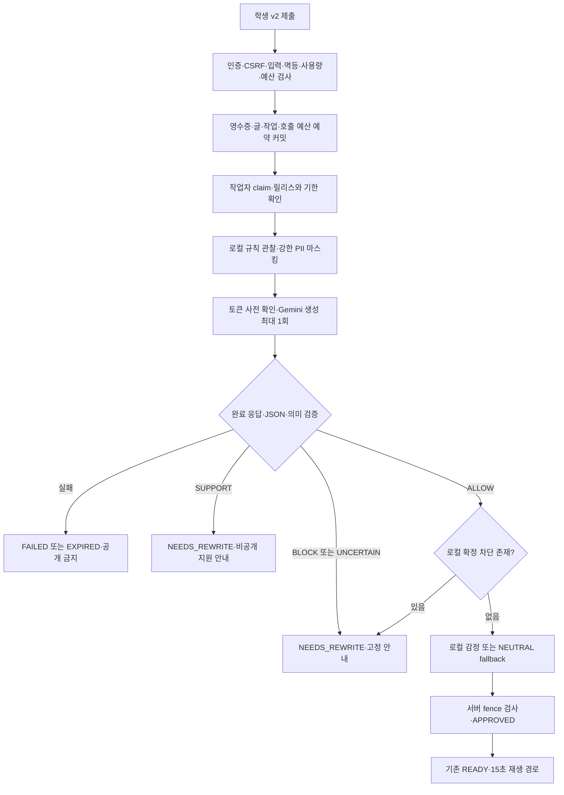

# Gemini를 이용한 무드월 자동 검수 설계

상태: 설계 기준 · 갱신일: 2026-11-05. Gemini를 서버 내부 검수에 사용한다는 전제로 작성했다. 공급자 허용 여부 확인을 이 설계의 선행 조건으로 두지 않는다. 실제 HTTPS transport·키 설정·토큰 사전 확인·사용량 정산과 서버·화면·원장을 구현했다. 실행 방법과 현재 검증 범위는 [구현 가이드](gemini-moderation-implementation.md)를 따른다. 실제 키로 호출하거나 학생 글 전송·실모델 성능 평가·운영 배포를 수행하지는 않았다. 아래 설계 중 현장 수락·평가·운영 자동화의 완료 여부는 구현 가이드와 실행 증거를 기준으로 판단한다.

정상 글은 운영자의 사전 승인 없이 자동 송출한다. [게시 정책](content-policy.md)을 Gemini가 분류하고, 서버가 결과를 검증해 게시를 결정한다. 감정 분류는 기존 로컬 모델을 선택적으로 사용한다. 아래 수치와 대응 기준은 무드월의 초기 선택이며 업계가 인증한 표준값은 아니다.

## 1. 설계 산출물과 우선순위

| 자료 | 역할 |
| --- | --- |
| [게시 허용과 차단 기준](content-policy.md) | 어떤 표현을 공개하는지 정하는 원문 정책 |
| 이 문서 | 요청·판정·DB·학생 화면·구현 순서의 기준 |
| [시스템 프롬프트](gemini-moderation-prompt.txt) | 정책을 분류기에 전달하는 재사용 가능한 지시문 |
| [응답 JSON Schema](gemini-moderation-response.schema.json) | 외부 모델의 출력 형태 제한 |
| [합성 회귀 예문](checks/gemini-moderation-cases.json) | 경계·사유 코드·프롬프트 공격 검토용 예문. 실제 성능 평가셋과 별개 |
| [평가와 수락 기준](gemini-moderation-evaluation.md) | 독립 평가셋·오탐·누락·장애·단계적 도입 조건 |
| [운영 상세](gemini-moderation-operations.md) | 시간·호출·쿼터·비용·장애·보관·복구 |

기존 [AI 계약](ai-contract.md)은 로컬 모델과 공통 `Analyzer`의 계약이다. Gemini 프로필은 이 문서의 추가 계약을 함께 적용한다. 실제 변경한 코드·OpenAPI·DB migration은 구현 가이드에 구분한다. 정책 변경은 게시 정책부터 수정하고 프롬프트·예문·평가·릴리스 버전을 함께 바꾼다.

## 2. 최종 선택

| 항목 | 초기 설계 |
| --- | --- |
| 검수 위치 | 브라우저가 아닌 독립 Python 작업자 내부 |
| 외부 모델 | `gemini-3.6-flash`를 초기 평가 후보로 고정. `latest` 별칭 사용 금지 |
| wire API | Interactions REST `POST /v1beta/interactions`, `Api-Revision: 2026-05-20` |
| 실행 | 제출마다 검수 workflow 최대 1회: countTokens 사전 확인 뒤 생성 최대 1회. 대화 이력·검색·도구·파일·명시적 캐시 없음 |
| 요청 저장 | `store=false`, `background=false`, streaming 없음 |
| 모델 역할 | `ALLOW / BLOCK / UNCERTAIN / SUPPORT`와 정해진 사유 코드만 반환 |
| 최종 게시 권한 | 서버. 모델 출력에는 SQL·게시 명령·제재·HTML·답변 생성 권한 없음 |
| 제재 | 새 Gemini 프로필 전체에서 `auto_strikes=false`. 비공개 판정으로 자동 벌점·정지를 만들지 않음 |
| 실패 | 비공개 기술 실패. 욕설 필터만으로 승인하거나 다른 모델로 자동 우회하지 않음 |
| 학생 화면 | v2와 지원 안내를 이해하는 클라이언트만 새 Gemini 제출 허용 |

선정 모델은 구조화 출력을 지원하는 stable ID다. 더 최신 모델로 자동 교체하지 않고 같은 평가를 거쳐 교체한다. 원격 stable ID가 가중치의 영구 불변을 보장한다고 해석하지 않는다. [모델 설명](https://ai.google.dev/gemini-api/docs/models/gemini-3.6-flash)

Interactions의 저장 기본값에 의존하지 않고 `store=false`를 명시한다. 이 설정을 공급자의 모든 보관·오용 탐지까지 0일로 만드는 보장으로 설명하지 않는다. 별도 학생 계정이나 Gemini 채팅 화면은 만들지 않는다. [저장 설정](https://ai.google.dev/gemini-api/docs/interactions-overview#data-storage-retention)

## 3. 한 글이 끝나는 전체 흐름



1. 같은 멱등 키의 재요청은 기존 영수증을 먼저 반환한다. 새 예약·모델 호출·게시 횟수를 만들지 않는다.
2. 서버는 기존 NFC·1~30 grapheme cluster·UTF-8 2,048byte·제어 문자 검사를 유지한다. 입력을 잘라서 통과시키지 않는다. 접수 자체가 불가능한 입력은 외부로 보내지 않는다.
3. 신규 접수는 작업자·provider 회로·전광판·쿼터·예산이 준비됐을 때만 원자적으로 커밋한다. 수락 뒤 실패해도 그 글이 게시됐다고 표시하지 않는다. 기존 완료 카드의 접수 의미는 유지한다.
4. worker가 claim을 획득한 뒤 로컬 규칙을 검사하되 **즉시 거절·벌점 확정을 하지 않는다.** 욕설이 섞인 자기 위기를 먼저 지원 경로로 보내기 위해서다. 문법상 유효하게 수락한 모든 글은 예산·기한이 허용하면 동일 검수 경로를 거친다.
5. 신뢰된 전처리가 강한 개인정보 패턴만 메모리에서 치환하고, 치환 문장과 boolean 플래그를 Gemini에 보낸다. 원문은 기존 보관 경계를 유지한다.
6. 단일 응답을 엄격하게 검사한다. `SUPPORT`를 먼저 처리하고, 다른 결과에는 로컬 확정 차단을 병합한다. 로컬 차단이 있으면 모델 `ALLOW/UNCERTAIN`을 공개로 쓰지 않는다.
7. 최종 `ALLOW`에만 로컬 감정을 붙인다. 감정 모듈이 없거나 실패하면 `NEUTRAL / score:null / source:FALLBACK`으로 간다. 안전성 오류는 감정 fallback으로 복구하지 않는다.
8. 현재 run token·DB lease·전체 기한·릴리스·전광판 상태를 다시 확인해 최종화한다. 늦은 응답·이전 세대·취소된 글은 승인할 수 없다. 승인 이후는 기존 v2 재생 규칙을 따른다.
9. 비공개 결과는 영수증에 학생용 사유를 먼저 저장한 뒤 원문을 즉시 제거하고 게시 사용량을 반환한다. provider 과금은 별도로 정산한다.

## 4. Gemini에 전달하는 정확한 정보

`system_instruction`에는 프롬프트 파일 전체를 넣는다. 정책 ID는 그 지시문 안에 고정한다. 학생의 요청을 같은 문자열에 이어 붙여 지시문으로 만들지 않는다. `input`에는 서버가 JSON serializer로 만든 다음 객체의 **문자열**만 넣는다.

```json
{
  "schema_version": "1",
  "text": "요즘 내 여드름 때문에 속상해",
  "local_findings": {
    "restricted_identifier": false,
    "confirmed_profanity": false
  }
}
```

외부로 보내지 않는 값은 학생·참여자·학교·전광판·제출 ID, IP, 쿠키, 세션, QR, 학급 명부, 과거 글, 사용자별 위반 기록이다. 학교급이나 이름 목록을 몰래 추가하지 않는다. 학생이 본문에 써 넣은 `local_findings`, 역할 선언, 가짜 JSON은 `text` 내부 데이터일 뿐 실제 플래그를 바꾸지 못한다.

### 로컬 개인정보 치환 계약

새 `redactor_version`의 검증된 패턴만 사용한다. 국내 전화번호 형태, 명백한 이메일 주소, 명시적으로 비밀번호라고 제시한 값 등 확정 패턴을 각각 `[연락처]`, `[이메일]`, `[비밀정보]`로 치환한다. 해당 위치의 실제 값·일부 숫자·추출 목록은 전송하지 않는다. `restricted_identifier=true`를 함께 보내고 서버도 같은 사실을 유지한다. 모호한 숫자나 이름처럼 보이는 일반 단어를 일괄 제거하지 않는다. 주소·학생 이름·반번호·별명 등 치환으로 확정할 수 없는 식별 맥락은 정책 분류 대상이며 탐지 누락 가능성이 남는다.

욕설은 문맥을 보존한다. `[욕설]`로 전부 가려 위기·인용·공격을 구별할 단서를 없애지 않는다. 확정 금칙어에만 `confirmed_profanity=true`를 붙이고 PII 치환 후 욕설 표면형을 보존한 문장과 함께 분류한다. 사전 밖 단어, 부분 문자열, `시발점` 같은 정상 단어를 확정 플래그로 만들지 않는다. PII 치환·욕설 규칙·NFC 전처리는 각각 버전과 합성 부정 예문을 가진다.

치환은 유출을 줄이는 수단이며 익명화가 완료됐다는 인증이 아니다. 모델이 가려진 값을 복원하게 하거나 전체 원문을 2차 요청으로 보내지 않는다. 플래그 때문에 공개할 수 없는 **원래 글**을 모델이 허용해도 서버는 차단한다. 모델이 고쳐 쓴 글·마스킹된 글을 학생 동의 없이 대신 게시하지 않는다.

### 요청 compiler

구현한 compiler는 아래 고정값과 패키징된 프롬프트·스키마 파일을 조합한다. [HTTPS transport](../backend/inference/gemini_http.py)는 이 요청을 검증한 뒤 countTokens와 Interactions를 호출한다.

```text
model = gemini-3.6-flash
system_instruction = UTF-8(gemini-moderation-prompt.txt)
input = JSON.stringify(위 검수 입력)
response_format = {type: text, mime_type: application/json,
                   schema: gemini-moderation-response.schema.json의 schema 본문}
generation_config = {max_output_tokens: 512, thinking_level: minimal,
                     thinking_summaries: none}
store = false
background = false
tools = 생략
previous_interaction_id = 생략
```

API key는 서버 비밀 설정에서 읽고 `x-goog-api-key` 헤더로만 전달한다. URL·프론트 번들·브라우저 요청·로그·문서에 넣지 않는다. 현재 Compose는 API와 worker에 키를 전달하며 실제 HTTP는 worker만 실행한다. 외부 endpoint는 고정 HTTPS origin과 countTokens·Interactions 두 경로만 허용하고 redirect·환경 프록시·자동 retry를 끈다. 응답은 identity 인코딩과 JSON만 받고 전체 64KiB에서 중단한다. 모델 JSON은 2KiB 이내로 제한한다.

입력 예약 상한은 16,384토큰이다. 전송할 정책·학생 입력·출력 스키마를 countTokens로 확인하고 1,024토큰 여유를 더한 값이 상한을 넘으면 생성하지 않는다. 이 사전 확인과 생성 사이의 API 표현 차이를 여유값으로 흡수하는 **보수적 추정**이며 정확한 청구 토큰·과금 상한을 입증한 것은 아니다. 실제 usage가 예약을 넘으면 정산한 뒤 추가 접수를 중단한다. 두 HTTP 요청은 한 검수 workflow로 원장에 연결하고 자체 RPM/RPD/TPM에는 모두 포함한다.

초기 safety 설정은 `hate_speech / dangerous_content / harassment / sexually_explicit / jailbreak` 각각 `block_medium_and_above`, `method=probability`로 고정한다. 지원하지 않는 설정이면 시작을 실패시키며 자동 제거·완화하지 않는다. 이 설정을 포함해 동일 조건으로 평가한다. provider의 안전 차단은 무드월 자체의 의미 판정과 별도로 기록한다. `generateContent`의 `generationConfig/candidates/finishReason` 문법을 이 어댑터와 섞지 않는다. [Interactions API 계약](https://ai.google.dev/api/interactions-api)

512는 내부 생각 token을 포함한 전체 생성 상한이다. 잘린 응답을 파싱해 일부 허용 판정을 얻지 않는다. 정확도·완료율이 수락 기준을 못 넘으면 상한·thinking 설정을 바꾼 **새 릴리스**를 다시 평가한다. temperature를 0으로 만들면 결정적이 된다고 가정하지 않는다. [생각·생성 상한 설명](https://ai.google.dev/gemini-api/docs/thinking#token-limits)

## 5. 출력 검증과 판정 우선순위

wire 응답의 `status`는 `completed`여야 한다. 요청 이력용 `user_input`이 반환되면 저장하지 않고 검사 대상에서 제외한다. `thought`에는 signature와 빈/누락 summary만 허용하고 저장하지 않는다. 모델 출력은 마지막 `model_output` 한 개, `content`의 text 한 개만 허용한다. tool call·continuation·추가 모델 출력·비텍스트·refusal·안전 차단·실패·불완전 결과는 기술 실패다. SDK의 편의용 `output_text`만 보고 전체 성공을 가정하지 않는다.

그 text 전체를 단일 JSON 객체로 파싱한다. 중복 key, BOM, 앞뒤 해설, 코드 fence, 다중 JSON, 허용하지 않은 필드, enum 오타, 길이 초과, 배열 중복은 거절한다. JSON 수리·정규식으로 일부 추출·기본값 `ALLOW`·추가 질문은 없다. 스키마 검증 뒤 아래 의미 제약도 검증한다. 구조화 출력은 정책상 올바른 결론까지 보장하지 않는다. [구조화 출력 설명](https://ai.google.dev/gemini-api/docs/structured-output)

| decision | reason_codes | policy_rule_ids | 서버 처리 |
| --- | --- | --- | --- |
| ALLOW | 빈 배열 | 빈 배열 | 로컬 확정 차단이 없을 때만 공개 후보 |
| BLOCK | 안전 위반 코드 1~5개 | 해당 차단 CP ID 1~5개 | 비공개 수정 안내 |
| UNCERTAIN | `INSUFFICIENT_CONTEXT`, `OUT_OF_DOMAIN` 중 정확히 1개 | `CP10`만 | 비공개 명확화 안내 |
| SUPPORT | `SELF_CRISIS` 필수, 다른 안전 위반 코드 추가 가능 | `CP08` 필수, 다른 해당 CP 추가 가능 | 비공개 지원 안내 우선 |

`BLOCK`의 허용 사유는 `HARASSMENT/HATE/SEXUAL_CONTENT/THREAT/PERSONAL_INFORMATION/OTHER_UNSAFE`다. `SELF_CRISIS`를 BLOCK·UNCERTAIN에 넣을 수 없다. SUPPORT에는 문맥 부족 코드를 섞지 않는다. CP별 사유 매핑이 맞아야 한다. 규칙이 5개를 넘으면 CP08 → trusted 플래그의 CP05 → trusted 플래그의 CP06 → CP04 → CP03 → CP02 → CP07 → CP09 → CP01 → 나머지 CP05·06 순으로 최대 5개를 고르고, 선택된 규칙의 고유 사유만 반환한다. 서버 병합에도 같은 우선순위를 적용한다. 점수·설명·학생에게 보일 문장·모델이 만든 버전은 받지 않는다. 안전성 score는 서버에서 항상 `null`이다.

| 규칙 | 범위 | 사유 코드 |
| --- | --- | --- |
| CP01 | 특정인 모욕·외모 조롱·따돌림·공개 망신 | HARASSMENT |
| CP02 | 보호 속성에 근거한 혐오·배제 | HATE |
| CP03 | 성희롱·노골적 성적 묘사·미성년 성적 대상화 | SEXUAL_CONTENT |
| CP04 | 실제 사람에 대한 위협·폭력 선동 | THREAT |
| CP05 | 학생 식별 정보·연락처·비밀·민감 사생활 | PERSONAL_INFORMATION |
| CP06 | 확정된 강한 욕설·성적 비속어 | OTHER_UNSAFE |
| CP07 | 자해 권유·미화·실행 방법·계획 전파 | OTHER_UNSAFE |
| CP08 | 작성자 자신의 현재 위기·도움 요청 | SELF_CRISIS |
| CP09 | 그 밖의 명확한 위험 행동·범죄 실행 조장 | OTHER_UNSAFE |
| CP10 | 판정에 필요한 문맥 부족·지원 범위 밖 | INSUFFICIENT_CONTEXT 또는 OUT_OF_DOMAIN |

사유와 규칙은 순서 없는 집합으로 비교한다. `OTHER_UNSAFE`에 CP06·07·09가 여러 개 연결될 수 있으므로 두 배열의 길이가 같아야 한다고 강제하지 않는다. 각 CP의 매핑 사유가 존재하고 각 사유에 대응 CP가 있어야 한다. 서버 플래그 병합에도 같은 제약을 적용한다.

최종 우선순위는 **유효한 자기 위기 SUPPORT → 명확한 공개 금지 → 판단 부족 → ALLOW**다. SUPPORT에는 다른 위해 사유도 유지하지만 공개·벌점은 없다. 명백한 차단 사유가 있으면 다른 맥락이 부족하다는 이유로 UNCERTAIN으로 낮추지 않는다. 위기 여부까지 확정할 수 없는 글은 UNCERTAIN으로 보내되 도움 안내 링크를 항상 볼 수 있게 한다. provider 실패에서도 같은 정적 도움 진입점을 유지한다.

허용하는 경계는 자기 외모 고민, 스타일 취향·공개 의상 비평, 부정 감정·학교 불만, 식별 정보 없는 피해 호소, 구체적 방법 없는 회복·예방 이야기다. 특정 학생의 외모 모욕, 긍정 표현에 섞인 학생 실명, 인용 속 실제 개인정보·강한 욕설 등 별도 금지 사유는 공개하지 않는다. 게임·창작·예방·부정문을 실제 위해로 오독하지 않고, `장난인데`라는 선언만으로 표적 모욕을 허용하지 않는다.

## 6. 기존 내부 계약과 영수증에 연결

외부 `decision`을 기존 `AnalysisResult`에 그대로 넣지 않는다. 별도 `ProviderModerationResult`로 검증하고 어댑터에서 아래처럼 변환한다. 현재 감정 라벨의 `SUPPORT`는 응원 배경이고, 검수의 SUPPORT는 자기 위기 지원이다.

| 최종 검수 | 내부 SafetyResult | emotion | moderation_status | v2 영수증 사유 |
| --- | --- | --- | --- | --- |
| ALLOW | ALLOW, 사유 없음, score null | 로컬 결과 또는 NEUTRAL fallback | APPROVED | 기존 승인 경로 |
| BLOCK | BLOCK, 병합한 위해 사유 | null | NEEDS_REWRITE | 기존 CONTENT_REQUIRES_REWRITE |
| UNCERTAIN | UNCERTAIN, 문맥/범위 사유 | null | NEEDS_REWRITE | 기존 CONTENT_REVIEW_UNCERTAIN |
| SUPPORT | BLOCK, SELF_CRISIS 및 다른 위해 사유 | null | NEEDS_REWRITE | **새 SUPPORT_AVAILABLE** |
| 기술 실패 | AnalysisResult를 만들지 않음 | 없음 | FAILED 또는 EXPIRED | 기존 안전한 기술 오류 사유 |

필요한 내부 enum 변경은 `ReasonCode`에 `SELF_CRISIS`를 추가하는 것이다. DB `moderation_status`와 SafetyVerdict에 SUPPORT를 추가하지 않는다. Gemini 프로필의 규칙 차단도 `ModelAnalyzed(BLOCK)` 계열로 최종화하고, 규칙 전용 `RuleRejected`·`REJECTED` 경로를 사용하지 않는다. 현재 DB는 `REJECTED`와 strike·rule evidence를 결합하므로 자동 제재를 끄면서 그 상태를 그대로 쓰면 모순이다. 상세 regex 매치 원문은 별도 저장하지 않는다.

provider 내부 오류는 기존 `RunFailed`로 축약한다. timeout→`INFERENCE_TIMEOUT`, 응답/스키마 이상→`INVALID_MODEL_OUTPUT`, 429/5xx/연결/안전 차단→`TRANSIENT_DEPENDENCY`, 인증/설정→`MODEL_NOT_READY`, 릴리스 불일치→`POLICY_VERSION_MISMATCH`. 운영 원장에는 더 자세한 오류 코드를 남기되 학생에게 공급자 본문을 반환하지 않는다. 안전 차단도 유해 글이 실제로 판별됐다는 통계로 합치지 않는다.

v2의 비승인 동기화는 원문 source를 즉시 purge한다. 따라서 `SELF_CRISIS`를 나중에 원문 행에서 찾는 방식은 실패한다. **지원 사유를 owner receipt에 저장 → 사용량 해제 → 원문 purge**를 같은 유효 최종화 흐름에서 보장한다. 영수증은 기존 24시간 동안 소유자에게만 조회 가능하고 원문은 포함하지 않는다. provider 원장 정산은 이 단기 원문 행에 cascade되어 사라지면 안 된다.

지원 영수증은 기존 v2 필드를 유지하고 `processingStatus=NEEDS_REWRITE`, `userStatus=NEEDS_REWRITE`, `presentationStatus=null`, `contentStatus=PURGED`, `reasonCode=SUPPORT_AVAILABLE`로 반환한다. API가 임의 `support` 문장 객체를 만드는 대신 클라이언트가 고정 문구를 선택하도록 구현했다.

> 많이 힘들었겠어요. 이 글은 전광판에 표시하지 않았어요. 지금 도움이 필요하다면 가까운 선생님이나 믿을 수 있는 어른에게 알려주세요.

버튼은 `도움받는 방법 보기`, `작성 화면으로`다. 첫 버튼은 앱에 포함된 정적 안내 페이지로 열고, 비공개 안내·믿을 수 있는 어른에게 도움 요청하기·직접 이용할 수 있는 검증된 지원 경로를 보여준다. 연락처는 배포 지역의 공식 출처로 확인해 정적 리소스로 관리한다. 모델이 상담·진단·전화번호·링크를 생성하지 않는다. 자동 신고·교사 연락·위치 추적·즉시 응답을 약속하지 않는다. 이 화면에서 원문을 재인쇄하거나 단순히 “표현을 바꾸세요”라고 제재하지 않는다.

학생 연결 모듈과 React 화면은 `reasonCode` 지원 분기를 `userStatus` 일반 분기보다 먼저 적용한다. 서버 문구만 바꾸는 방식에 의존하지 않으며, 늦게 도착한 과거 결과가 새 초안을 덮지 않도록 기존 intent fencing을 유지한다.

### 구버전 화면의 오안내 방지

Gemini 프로필 신규 접수는 `/api/v2/submissions`에서만 받는다. 지원 화면을 구현한 학생 클라이언트는 `X-Moodwall-Client-Features: support-v1` 헤더를 보낸다. Gemini 프로필에서 신규 접수와 소유자 결과/멱등 조회에 이 기능이 없으면 원문·지원 사유를 일반 수정으로 돌려주지 않고 `409 CLIENT_UPDATE_REQUIRED` 고정 안내로 새로고침을 유도한다. 이 헤더는 인증 수단이 아니며 세션·CSRF·소유권 검사를 대신하지 않는다. 신규 접수의 본문 저장·예산 예약 전에 검사하며, 기존 결과 조회는 소유권 확인 뒤 검사해 타인의 지원 결과 존재를 노출하지 않는다.

v1 새 접수는 Gemini 활성 전광판에서 같은 업데이트 오류로 닫는다. 기존 v1 영수증·기존 프로필은 보관 기한까지 원래 계약을 따른다. v2 영수증에 `required_client_features` 메타데이터를 수락 시 저장하고, 조회·멱등 복구에서는 현재 전광판 설정 대신 이 값을 사용한다. 프로필을 되돌려도 이미 생긴 지원 결과의 표시 계약을 잃지 않는다. 이 필드는 원문·진단을 담지 않으며 학생 DTO에 새 필드로 반환할 필요는 없다. 새 HTML은 `no-cache`, 자산은 해시 파일명으로 배포한다. 이미 열린 구버전 탭까지 서버 capability 검사로 다룬다. OpenAPI·오류 enum·모의 서버·클라이언트·실제 UI를 같은 릴리스로 배포해야 한다.

## 7. 릴리스·동시성·재호출 경계

`release_id=SHA256(canonical manifest payload)`를 사용한다. payload에는 정책·프롬프트·schema·few-shot·전처리·PII 치환·욕설 사전·모델 ID·API revision·안전 설정·생성 설정·어댑터·의존성 잠금·선택 감정 bundle·tariff 버전을 포함한다. `release_id`와 이 값에서 파생하는 bundle version 필드는 payload 밖 envelope에 두어 자기참조 해시를 만들지 않는다. key나 학생 글은 해시에 넣지 않는다. 원격 모델의 반환 model 이름을 확인하고, 제공되는 revision 정보만 기록한다. 관측할 수 없는 가중치 revision을 추정해 적지 않는다.

기존 `moderation_policy_version`을 이 릴리스 ID로 사용하고, manifest의 bundle version·readiness·입력 수락·claim·finalize가 같은 ID를 검사하게 한다. 의미가 일부만 같은 문자열을 버전으로 재사용하지 않는다. `inference_policy_version`은 생성·의미 검증 설정의 고정 버전이다. 배포 도중 설정만 갈아끼우지 않는다. 접수 중단 → 기존 작업 drain 또는 명시적 실패 → 새 bundle 활성화 → probe → 접수 재개 순서다.

동일 제출의 외부 검수 workflow는 최대 1회이며 countTokens 1회와 생성 최대 1회로 구성한다. durable 원장의 `UNIQUE(submission_id)`와 `RESERVED→STARTED` 조건부 전이를 첫 HTTP **전에 커밋**한다. crash·timeout·응답 유실 뒤 STARTED를 새 호출 권한으로 되돌리지 않는다. 송신 전후를 알 수 없는 경우 비용은 UNKNOWN, 글은 비공개 실패다. 제공자 멱등 실행을 가정하지 않는다. 같은 결과의 DB 최종화 재시도만 token·lease 안에서 허용한다.

claim 15초, provider 두 요청 전체 8초, 연결 2초, 감정을 포함한 wrapper 12초, 최종화 여유 2초를 사용한다. 선택적 로컬 감정은 wrapper의 남은 시간 안에서 실행하며 독립적인 1초 강제 종료는 보장하지 않는다. 전체 접수 기한은 기존 120초 또는 KST 자정 중 빠른 시점이다. 실제 프로필의 RPM 6·입력 TPM 200,000·RPD 1,000·USD 3/KST일·동시 workflow 1은 초기 내부 상한이다. 자체 쿼터가 두 HTTP를 세므로 RPM 6은 분당 약 3개 workflow다. startup·복구의 합성 probe도 같은 원장과 비용을 사용한다. 상세 예약·공식 단가 구간·회로·정산·복구는 [운영 설계](gemini-moderation-operations.md)를 따른다.

## 8. 단문 분류가 놓치는 공격과 사고 대응

정책과 프롬프트만으로 교내 은어·당사자만 아는 별명·화면 밖 사건을 알아낼 수 없다. 프롬프트에 학급 명부·과거 글을 더 넣는 것으로 초기 문제를 해결하지 않는다. 학생당 최근 60분 3회, 기존 접수 속도 제한, 전광판 전체 처리량 제한을 함께 유지한다. 비승인으로 게시 quota가 반환돼도 별도 요청 제한은 소모되어 API 반복 공격을 억제한다.

동일 글 도배 탐지는 필요할 때 메모리의 전광판별 단기 HMAC 지문으로 120초만 유지하고 raw text·일반 SHA·장기 사용자 추적 자료로 저장하지 않는다. 동일 글 3번째부터 접수를 429로 제한하는 초기 규칙을 회귀 평가한다. 공통 응원 구호도 제한될 수 있으므로 차단 수·오탐을 별도로 기록한다. 문구를 조금씩 바꾸거나 여러 계정이 분할한 저격을 이 규칙이 해결한다고 주장하지 않는다.

피해 신고는 모델 재판정과 분리한다. 구현할 `POST /api/v2/reports`는 학생 세션·CSRF·board 범위·UUID 멱등 키를 검사하고 `{category, submissionId?}`만 받는다. category는 `HARASSMENT/PRIVACY/THREAT/OTHER` 고정값, 본문·타인 이름·스크린샷 업로드는 받지 않는다. ID가 없으면 서버 수신 시각과 현재 재생/말풍선 ID 메타데이터를 연결한다. 참여자당 10분 3회 제한, 같은 키 재전송은 기존 신고 ID를 반환한다. 다른 사용자의 ID·원문을 조회하는 API로 쓰지 않는다.

새 신고는 202 `{reportId,status:RECEIVED}`, 같은 키·같은 내용은 200, 같은 키·다른 내용은 409, 입력 오류는 422, 한도 초과는 429다. `submissionId`가 있으면 같은 전광판의 공개 이력이 있는 ID만 허용하고, 존재하지 않거나 타 전광판의 ID는 동일한 404를 반환한다. 신고 ID 자체로 원문 접근 권한을 만들지 않는다. ID 없는 신고는 특정 글을 확정한 것으로 취급하지 않는다. 학생 화면의 정적 신고 진입점은 작성 완료 카드와 도움말에 두며 검수 원문을 다시 입력받지 않는다.

신고는 자동 벌점·자동 공개 삭제로 연결하지 않는다. 악의적인 집단 신고가 글을 마음대로 지우게 하지 않기 위해서다. 인증된 운영자는 신고 큐와 메타데이터를 확인하고 기존 숨김·전체 송출 중단 기능으로 대응한다. 원문 보관 기한이 끝났으면 내용을 복구할 수 없다고 표시한다. 원문 보관을 늘려 증거를 몰래 수집하지 않는다. 신고 응답·운영 조회·처리 결과의 OpenAPI와 권한을 구현 단계에서 추가한다.

운영 큐는 `GET /api/operator/reports`의 전광판 범위·cursor 조회, 처리 기록은 CSRF와 명령 멱등 키를 검사하는 `POST /api/operator/reports/{reportId}/resolve`로 정의한다. 처리값은 `HIDDEN/BOARD_PAUSED/NO_ACTION/INSUFFICIENT_EVIDENCE` 고정값이다. 숨김·중단은 기존 권한·명령을 거친 뒤 처리 기록을 남기며, resolve 호출만으로 숨김 성공을 꾸미지 않는다. 신고 메타데이터·멱등 키는 7일 후 제거하고 이후에는 일별 건수만 남긴다. 지원 결과나 미송출 글은 공개 신고 목록에 들어가지 않는다.

상주 사전 검수는 없지만 서비스 책임자·기술 대응자와 연락 경로는 정한다. 심각한 위협·성적 대상화·개인정보 노출 확인 시 신규 접수와 해당 전광판 송출 중단 → 해당 글과 당일 캐시 숨김 → 사고 범위·릴리스·시각 기록 → 수정 및 재평가 → 명시적 재개 순서다. 긴급 숨김이 1시간 뒤 로컬 말풍선에도 전파되는지 실제 장치에서 검증한다. 대응 시간·가용 인력이 없는 상태를 “무인이라 대응 불필요”로 처리하지 않는다.

## 9. 구현 변경과 운영 수락 증거

1~8의 서버·화면·원장·실제 HTTP 경로를 구현했고 `0007_provider_moderation` migration과 함께 제공한다. 개별 항목의 실제 시험 범위는 [구현 가이드](gemini-moderation-implementation.md)를 따른다. 표의 완료 증거 중 실제 장치·독립 모델 평가·운영 canary는 앞으로 수행할 수락 항목이며 코드가 존재한다는 이유로 통과 처리하지 않는다.

| 순서 | 변경 대상 | 완료 증거 |
| --- | --- | --- |
| 1 | `backend/inference/contracts.py`, 새 provider DTO/semantic validator, OpenAPI reason·409 업데이트 계약 | 정상 4결과·중복/모순/알 수 없는 필드·support 매핑 검증 |
| 2 | `backend/inference/provider_moderation.py`, `backend/inference/gemini_http.py`, request compiler·redactor·HTTP transport | 기록된 합성 wire fixture로 completed·refusal·truncation·공격·timeout 재현. 실제 key 없는 테스트 가능 |
| 3 | `backend/inference/loader.py`, manifest·선택 감정 로딩·명시적 합성 probe | artifact 불일치·key 누락·감정 실패·provider 실패의 readiness 분리 |
| 4 | DB migration, `backend/app/config.py`, provider 원장·예산·회로 모듈 | 동시 접수·자정·프로세스 종료·UNKNOWN 정산·역순 잠금 방지 시험 |
| 5 | `backend/app/worker.py`, `backend/app/moderation.py` | 로컬 규칙 즉시 확정 제거, SUPPORT 우선, 벌점 0, 동일 제출 dispatch≤1, 늦은 응답 비승인 |
| 6 | `backend/app/playback.py`, v2 접수·조회·영수증 serializer·required_client_features migration | SUPPORT_AVAILABLE 저장 후 purge, 소유자 재조회·멱등 복구·프로필 rollback·24시간 만료 |
| 7 | `clients/student/submission-client.mjs`, `frontend/src/student/StudentApp.jsx`, 정적 도움 안내 | 지원 화면·업데이트 헤더·구버전 업데이트 요구·과거 응답 격리·원문 미노출 |
| 8 | 신고 API·운영 큐·기존 숨김/중단 연결, 관련 OpenAPI·클라이언트 | 악의적 신고 한도·권한·원문 만료·말풍선 캐시 숨김 현장 시험 |
| 9 | 독립 정책 평가·부하/비용/장애·개인정보 흐름 검사 | [평가 설계](gemini-moderation-evaluation.md)의 수락 보고서와 고정 release hash |
| 10 | 제한된 전광판 canary·단계 확대·복구 훈련 | [운영 설계](gemini-moderation-operations.md)의 관측·중단·rollback 기록 |

개발용 fake와 로컬 v0를 운영 Gemini 대체재로 켜지 않는다. 첫 실험은 합성 글만 사용한다. 평가 기준을 넘지 못하면 접수를 닫은 채 프롬프트·정책·모델을 수정하고 새로운 독립 평가를 한다. 유효한 ALLOW만 공개되는지와 유해 글이 ALLOW로 잘못 나오는지는 별도 검증 대상이다.

설계의 완료는 위 계약·실패 분기·화면·평가·운영 경로가 정의됐다는 뜻이다. 실제 운영 가능 여부는 구현과 수락 증거로 판단한다. 보이지 않는 교내 맥락, 공급자 모델 변화, 오탐·누락, 신고 전 노출까지 없애는 무오류 설계는 아니다.

## 10. 설계 산출물의 오프라인 검사

저장소 루트에서 `node docs/checks/verify-gemini-design.mjs`를 실행한다. 이 검사는 응답 schema의 제한된 구조, 합성 예문·프롬프트 예시의 의미 제약, 배열·사유 매핑·플래그, 글자 길이, 잘못된 조합 거절, 관련 문서의 상대 링크·JSON 예시를 확인한다. 공급자 key·네트워크·DB를 사용하지 않는다. [검사 코드](checks/verify-gemini-design.mjs)는 설계 산출물 검사이며 운영용 검수 어댑터나 실제 모델의 정책 정확도를 검증한 결과로 사용하지 않는다.
