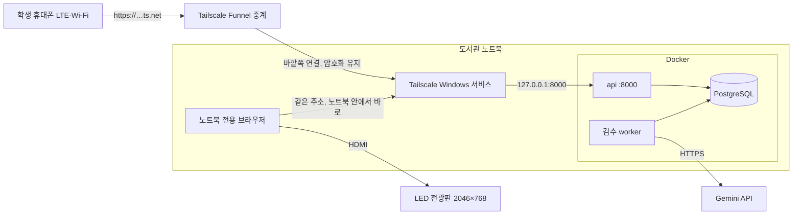

# 도서관 노트북 운영 — 노트북을 서버로 쓰는 구성

갱신일: 2026-11-10(공개 주소를 Cloudflare 터널에서 Tailscale Funnel로 변경). 학교 도서관 LED 전광판 한 대에 노트북 한 대를 연결해, **노트북이 서버(API·검수 작업자·DB)와 전광판 화면을 함께 맡는** 구성의 설치·운영 기준이다. 개발 PC에서 자동 시험과 2046×768 헤드리스 렌더링으로 확인했다. 실제 도서관 노트북·전광판·학교망에서 수행하는 현장 수락 시험(아래 7절)은 아직 하지 않았다.

## 1. 왜 노트북을 서버로 쓰는가

[전광판 노트북 문서](display-laptop.md)는 처음에 클라우드 서버를 권장했다. 다만 도서관 운영 조건에서는 노트북 하나로 운영하는 편이 더 단순하다.

| 조건 | 노트북 서버에 유리한 이유 |
| --- | --- |
| 전광판은 개관 시간에만 켠다 | 서비스가 필요한 시간이 노트북이 켜져 있는 시간과 같다. 전광판이 꺼지면 접수도 `DISPLAY_OFFLINE`으로 막힌다 |
| 글은 최대 1시간, 화면 캐시는 자정까지만 남는다 | 백업할 장기 데이터가 거의 없다. 노트북이 고장 나도 잃는 것은 운영자 계정과 장치 등록 정도다 |
| 직원은 켜기/끄기만 한다 | 아이콘 두 개로 끝난다. 클라우드 콘솔이나 월 서버 비용이 없다 |

**전제 조건:** 아래 조건을 충족하지 못하면 클라우드 구성으로 돌아간다.

- **학생 휴대폰이 노트북에 닿는 고정 HTTPS 주소.** Windows에 설치한 **Tailscale Funnel**을 쓴다. 무료이고 도메인 구매가 필요 없으며, `https://<노트북 이름>.<tailnet>.ts.net` 주소와 인증서를 Tailscale이 발급·갱신한다. 노트북에서 바깥쪽으로 나가는 연결만 사용하고, 학교망에 들어오는 포트는 열지 않는다.
  - `localhost`나 교내 사설 IP는 LTE 휴대폰이 접속할 수 없고, 학교 Wi-Fi는 보통 기기끼리 통신을 막는다. 사설 IP는 바뀌기도 하고 HTTPS를 쓸 수 없어서 운영 모드 서버가 시작을 거부한다.
  - 주소가 매번 바뀌는 임시 터널은 재시작할 때마다 QR과 장치 등록이 깨지므로 쓰지 않는다.
  - 도메인을 따로 사게 되면 그 주소를 `MOODWALL_PUBLIC_ORIGIN`에 넣고 Tailscale 대신 다른 터널을 써도 된다. 런처는 `.ts.net` 주소일 때만 Tailscale을 검사한다.
- **학교망 확인.** 학교 Wi-Fi에서 Tailscale 연결과 Gemini API(`generativelanguage.googleapis.com`)가 막히지 않는지 현장에서 확인한다(7절). 몇 시간마다 다시 로그인을 요구하는 Wi-Fi라면 유선 LAN을 쓴다.
- **노트북 사양.** RAM 8GB 이상이 필요하고, 감정 모델(`compose.gemini-emotion.yaml`)을 쓴다면 16GB를 권장한다. Docker Desktop(WSL2·가상화)을 설치할 관리자 권한이 처음 1회 필요하다.
- **복원 솔루션(재부팅 시 초기화) 없음.** 재부팅할 때마다 프로필과 DB가 지워지면 매일 장치를 다시 등록해야 한다.

## 2. 전광판 사양과 화면 반영

| 항목 | 값 |
| --- | --- |
| 해상도 | 2046 × 768 (2.664:1) |
| 실물 | 8000 × 3000 mm |
| 픽셀 피치 | 약 3.9 mm (P4급) |

- **화면 틀:** 2:1~3:1 비율의 화면은 빈 띠 없이 꽉 채운다. 기존에는 3:1로 고정되어 위아래에 43px씩 빈 띠가 생겼다. 1u는 화면 폭의 1%로, 이 전광판에서는 약 20.5px이다.
- **글자:** 뜻을 전하는 글자는 최소 1u(약 20px, 실물 약 8cm)로 맞췄다. 기존에는 0.7~0.875u(14~18px)였는데, LED에서는 한글 획이 뭉개진다.
- **QR:** 참여 주소는 약 400자이고 QR 15버전(81칸, 여백 포함)이 된다. 칸 하나가 정수 배의 실제 픽셀에 찍히도록 그린다([LedQr.jsx](../frontend/src/display/LedQr.jsx)).
  - 메인 QR과 15초 화면 QR 모두 칸당 3px이다. 실물로 칸 약 1.2cm, QR 약 95cm다.
  - 기존 15초 화면 QR은 칸당 1.16px이라 LED에서 읽히지 않았다.
- **Windows 설정:** 디스플레이 배율은 100%를 권장한다. 다른 배율에서도 정수 배를 계산하지만, 100%가 가장 선명하다.
- **동작 고정:** Windows "애니메이션 효과" 설정과 관계없이 구름이 움직인다. 공용 전광판에서는 노트북의 설정이 관람자의 선호를 뜻하지 않기 때문이다.
- **움직이는 구름 수:** 화면에서 움직이는 구름은 최신 30개로 제한한다. 제목의 개수와 무드 예보는 그날 받은 구름 전체로 계산한다. 값은 [DisplayApp.jsx](../frontend/src/display/DisplayApp.jsx)의 `MAX_DRIFTING_CLOUDS`에서 바꾼다.

## 3. 구성



- TLS는 노트북의 Tailscale이 직접 푼다. 중계 서버는 암호화된 내용을 보지 못한다.
- 노트북 브라우저는 같은 주소를 쓰지만 노트북 안에서 바로 처리되므로 Funnel 대역폭을 쓰지 않는다.

**모든 곳에 주소 하나.** `.env`의 `MOODWALL_PUBLIC_ORIGIN`을 Funnel 주소로 둔다. QR, 운영자 화면, 전광판이 모두 이 주소를 쓴다.

- 노트북 브라우저도 `http://localhost:8000`이 아니라 이 주소로 연다. 서버는 모든 POST의 `Origin`이 이 값과 정확히 같아야 통과시킨다.
- 런처 설치 도구는 이 값을 `.env`에서 직접 읽고, 다르면 설치를 거부한다. `.ts.net` 주소면 Tailscale이 로그인되어 있는지, 이 노트북의 주소인지, Funnel이 `127.0.0.1:8000`으로 공개되어 있는지도 확인한다.
- 직원 설정 화면도 주소가 다르면 경고한다.

## 4. 최초 1회 설치 (개발자 또는 관리자)

현장에서 순서대로 따라 할 체크리스트(사람·코딩 에이전트 겸용, 직원 안내 포함)는 [11.10 노트북 세팅](11.10-노트북-세팅.md)에 있다.

1. **노트북 확인:** 위 전제 조건, Edge 또는 Chrome, 전원 어댑터 상시 연결.
2. **Docker Desktop:** 설치 후 설정에서 *Start Docker Desktop when you sign in*을 켠다.
3. **저장소와 비밀값:** 저장소를 예를 들어 `C:\moodwall`에 받는다. 개발 PC의 `.env`를 복사하지 않는다. 그 파일에는 개발용 Gemini 키와 DB 비밀번호가 들어 있다.
   - 노트북에서 `python scripts/setup_gemini.py --start --create-operator --operator-name admin`을 실행한다([Gemini 실행 가이드](gemini-moderation-implementation.md)).
4. **Tailscale (한 번만 하면 이후 손댈 일이 없다):**
   1. [tailscale.com/download](https://tailscale.com/download)에서 Windows용을 설치하고 무료 계정으로 로그인한다. 계정 주인은 운영 책임자(담당 교수) 또는 인수인계할 수 있는 사람으로 정한다.
   2. 작업 표시줄의 Tailscale 아이콘 → Preferences → **Run unattended**를 켠다. 어느 Windows 계정으로 로그인하든, 로그인 전에도 연결된다.
   3. [관리 화면](https://login.tailscale.com/admin/machines)에서 이 노트북의 ⋯ 메뉴를 연다.
      - **Edit machine name**으로 `moodwall-library`처럼 바꾼다. 주소에 쓰이므로 나중에 바꾸면 QR 주소도 바뀐다.
      - **Disable key expiry**를 누른다. **빠뜨리면 180일 뒤 갑자기 공개 주소가 끊긴다.**
   4. 관리자 PowerShell에서 아래를 실행한다.
      ```powershell
      tailscale set --auto-update
      tailscale funnel --bg 8000
      tailscale funnel status
      ```
      처음에는 Funnel 사용 승인 링크가 나온다. 링크를 열어 승인하고 다시 실행한다. `--bg` 설정은 재부팅 뒤에도 유지된다. 마지막 줄에 나오는 `https://moodwall-library.<tailnet>.ts.net`이 공개 주소다. 처음 공개한 뒤 바깥에서 접속되기까지 최대 10분 정도 걸릴 수 있다.
   5. `.env`에 그 주소를 넣는다.
      ```
      MOODWALL_PUBLIC_ORIGIN=https://moodwall-library.<tailnet>.ts.net
      ```
5. **빌드와 실행:**
   ```powershell
   npm --prefix frontend ci; npm --prefix frontend run build
   docker compose -f compose.yaml -f compose.frontend.yaml -f compose.gemini.yaml -f compose.library.yaml up -d --build api worker
   ```
   LTE 휴대폰으로 `https://…ts.net/operator`가 열리고 로그인되면 공개 주소가 정상이다.
   감정 색 모델을 쓰면 `compose.library.yaml` 앞에 `-f compose.gemini-emotion.yaml`을 넣는다. 런처 설치 때도 `-ComposeFiles`에 같은 목록을 준다.
6. **Windows 설정** (직원 계정):
   - 전원 연결 시 절전 "안 함", 화면 끄기 "안 함"
   - 덮개를 닫을 때 "아무것도 안 함"
   - 화면 보호기 끄기, 알림은 방해 금지
   - Windows Update 사용 시간을 개관 시간으로 지정
   - `Win+P` → **두 번째 화면만**, 해상도 2046×768, 배율 100%
   - 화면이 보이는 동안에는 웹페이지도 Wake Lock으로 절전을 막는다. 다만 OS 설정이 먼저 맞아야 한다.
7. **아이콘 설치** (직원 Windows 계정에서):
   ```powershell
   powershell.exe -NoProfile -ExecutionPolicy Bypass -File ".\ops\display-launcher\Install.ps1" -ServerRoot "C:\moodwall" -AutoStart
   ```
   바탕화면에 **무드월 켜기**, **무드월 끄기**, **무드월 직원 설정·점검**이 생긴다. `-AutoStart`를 주면 Windows 로그인 직후 켜기가 자동으로 실행된다. 주소는 `.env`에서 읽는다. Tailscale 설정이 빠졌으면 무엇을 해야 하는지 알려 주며 설치를 거부한다.
8. **전광판 등록:**
   - **무드월 켜기**를 누른 뒤, 로고만 보이면 창을 `Alt+F4`로 닫는다.
   - **직원 설정·점검 → 등록·설정 열기**를 누른다.
   - 휴대폰에서 `https://…ts.net/operator`에 로그인해 등록 코드를 발급하고, 노트북에 입력한다.
   - 운영자 화면에서 **접수 재개·송출 재개**를 누른다.
   - 설정 창을 닫고 **무드월 켜기**를 다시 누른다.
   - 장치 등록은 전광판을 쓰는 동안 자동으로 연장된다. **180일 동안 한 번도 켜지 않았거나** 운영자가 장치를 해지했을 때만 같은 방법으로 다시 등록한다.

## 5. 직원용 안내 (한 장)

> **출근할 때**
> 1. 노트북을 켜고 로그인합니다.
> 2. 1~3분 기다리면 전광판에 무드월이 나옵니다. 자동으로 안 나오면 바탕화면의 **무드월 켜기**를 두 번 누릅니다.
> 3. "무드월을 켜고 있어요" 화면이 나오면 그대로 기다립니다.
>
> **퇴근할 때**
> 1. 바탕화면의 **무드월 끄기**를 두 번 누릅니다. 전광판이 닫히고 "이제 노트북을 꺼도 괜찮아요"가 나옵니다.
> 2. 노트북을 끕니다.
>
> **이럴 때는**
> - "인터넷 주소 연결 프로그램(Tailscale)이 꺼져 있어요"가 나오면: 화면 오른쪽 아래 Tailscale 아이콘을 눌러 **Connect**를 누르고 **무드월 켜기**를 다시 누릅니다.
> - "무드월을 켜지 못했어요"가 나오면: 인터넷을 확인하고 노트북을 다시 시작한 뒤 **무드월 켜기**를 누릅니다. 그래도 안 되면 담당 선생님께 알립니다.
> - 전광판에 MOOD WALL 로고만 계속 보이면: **무드월 끄기** → **무드월 켜기**. 계속되면 담당 선생님께 알립니다(장치 등록 만료일 수 있음).
> - 이상한 글이 보이면: 담당 선생님께 알립니다. 운영자 화면에서 숨길 수 있습니다.
> - 브라우저 데이터 지우기, 다른 프로그램으로 화면 덮기는 하지 않습니다.

### 담당자 유지보수

| 항목 | 누가 | 주기 |
| --- | --- | --- |
| Tailscale 주소·인증서 갱신·재연결·업데이트 | 자동(4절 설정 뒤) | 없음 |
| Docker·DB·검수 작업자 시작 | 자동(**무드월 켜기**) | 없음 |
| 전광판 장치 재등록 | 담당자 | 보통 없음. 켤 때마다 자동 연장되고, 180일 넘게 안 켰거나 해지했을 때만(4절 8단계) |
| Gemini 키·결제 | 담당 교수 | 키를 바꿀 때만 |
| Tailscale 계정 인수인계 | 담당자 | 담당자가 바뀔 때. 계정이 바뀌면 주소가 바뀌어 `.env` 수정과 아이콘 재설치가 필요하다(화면 QR은 자동으로 바뀐다) |

## 6. 자정·운영 시간

- **운영 시간:** 직원이 켜고 끄는 시간이 곧 운영 시간이다. 전광판이 꺼져 있으면 30초 안에 온라인 허가가 끝나고, 새 접수는 기존 `DISPLAY_OFFLINE`으로 거절된다. 폐관 뒤 글이 아무에게도 보이지 않고 사라지는 것은 의도한 동작이다. 요일·공휴일별 자동 일정은 없다.
- **00시 초기화:** 노트북이 켜져 있으면 KST 자정에 화면의 모든 구름이 지워진다. 1시간 이내 글과 투명 구름 모두 해당하며, 1시간 규칙과 무관하다. 기준은 서버 시각이다.
  - 브라우저 저장소도 함께 비운다. 꺼져 있었다면 다음 시작 때 전날 캐시를 먼저 지운다.
  - 서버는 자정 20초 전부터 새 접수와 재생 시작을 막고, 전날 글은 `DAY_ENDED`로 끝낸다.
  - 자동 시험: [playback-bubble-cache.test.mjs](../clients/display/playback-bubble-cache.test.mjs)의 "KST midnight clears every cloud…".

## 7. 현장 수락 시험 (미실행)

같은 노트북·케이블·전광판·학교망에서 실행하고 날짜와 확인자를 기록한다.

1. 휴대폰 LTE로 QR → 제출 → 15초 재생 → 구름까지 확인한다. QR은 3m, 6m, 10m 거리에서 각각 인식되는지 본다.
2. 출근 동작: 전원 → 로그인 → 자동 또는 **무드월 켜기** → 전광판 표시까지 걸린 시간.
3. **무드월 끄기** 뒤 학생 접수가 막히는지, 다음 날 **켜기** 뒤 전날 구름이 남지 않는지 확인한다.
4. 인터넷 10분 단절 뒤 자동 복구, Windows 재부팅 뒤 장치 등록 유지.
5. 6시간 연속 표시 중 발열과 끊김. 구름 30개를 채운 상태로 본다.
6. 학교 Wi-Fi에 연결한 휴대폰으로도 QR 접속이 되는지 확인한다. 웹필터가 `ts.net`이나 Gemini를 막을 수 있다. 403 차단 페이지가 오면 화면은 조용히 재시도한다.
7. 쉬는 시간처럼 수십 명이 동시에 QR을 찍는 상황에서 페이지가 늦게 열리지 않는지 본다. 무료 Funnel에는 공개되지 않은 대역폭 제한이 있다.

## 8. 남은 한계와 후속 제안

- **QR 밀도(백엔드):** 서명된 JWT ticket(약 340자) 때문에 QR이 15버전이다. ticket을 짧은 형식으로 바꾸면 7버전 안팎(45칸)이 되어 같은 크기에서 칸이 약 1.7배 커지고, 더 멀리서 인식된다.
- **IP 기준 한도:** Funnel 뒤에서는 모든 학생 요청이 노트북 내부 주소 하나로 보인다. 학생 입장 IP 한도(분당 600)를 학생 전체가 나눠 쓴다. 도서관 규모에서는 충분하지만, 보안 이벤트의 IP 정보는 의미가 없다.
- **재생 시간:** 대기량과 관계없이 15초 고정이다. 기존 `.env`의 `MOODWALL_PLAYBACK_MAX_SECONDS`·`MOODWALL_PLAYBACK_MIN_SECONDS`·`MOODWALL_PLAYBACK_RELAXED_BACKLOG` 값은 무시한다. 업데이트 전에 시작한 시도만 저장된 재생 시간을 유지한다.
- **구름과 제목 겹침:** 구름이 가운데 제목 뒤를 지나며 글자와 겹친다. 기존 시안의 동작이며 디자인 담당과 정할 사항이다.
