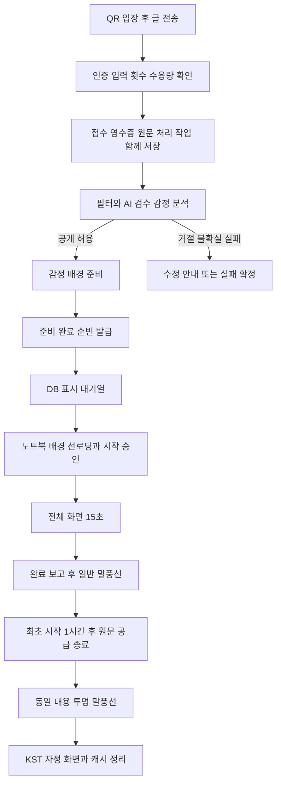

# 무드월 준비 완료 순서와 15초 재생 설계

2026-11-09: 전체 화면 시간은 **서버가 claim 때 정한다**. 뒤에 대기하는 글이 2개 이하면 15초, 그보다 많으면 1개당 1초씩 줄여 최소 8초(`PLAYBACK_MAX_SECONDS`·`PLAYBACK_MIN_SECONDS`·`PLAYBACK_RELAXED_BACKLOG`). 시도 응답의 `durationMs`(5000~15000)를 전광판이 따르고 서버 complete와 DB 제약도 같은 값으로 검증한다. 아래의 “15초”는 이 기본값이다. OpenAPI 0.12.0, DB head `0009_playback_duration`.

2026-11-05 추가 구현: [전광판 오류 비노출과 기존 동작 보존](display-recovery-design.md)을 코드에 반영했다. 공개 오류 안내와 자동 등록 화면 전환을 분리하고 이 문서의 재생·보관 계약을 유지한다. 최신 계약은 HTTP 0.11.0, DB head는 `0008_display_diagnostics`이며 [현재 구현과 검증 범위](display-recovery-implementation.md)를 따른다.

기준일: 2026-11-04. v2 재생 API·영수증·DB migration과 독립 클라이언트 모듈을 구현했다. HTTP 계약은 0.8.0, DB head는 `0006_playback_receipts`다. 실행 경로·실제 검증·미완료 범위는 [로컬 구현 가이드](playback-local-implementation.md)와 [구현 상태](implementation-status.md)를 따른다. 생성형 배경은 향후 확장이며 현재는 감정별 고정 테마 메타데이터를 준비한다.

## 확정한 동작과 초기 운영값

학생 글은 필터·AI 검수·감정 분석·배경 준비가 끝난 뒤 표시 대기열에 들어간다. 순서는 **준비 완료를 DB에 확정한 순서**다. 전광판은 한 글을 정상적으로 15초 동안 전체 화면에 표시하고, 새 글이 도착해도 먼저 교체하지 않는다. 끝난 글은 일반 말풍선이 된다. 최초 표시 시작을 기준으로 1시간 후 서버의 원문 공급을 끝내고, 노트북에서는 같은 내용의 투명 말풍선을 다음 KST 자정까지 유지한다.

| 항목 | 기준 | 결정 구분 |
| --- | --- | --- |
| 전체 화면 | 글 하나씩 15,000ms, 준비 완료 순서 | 사용자 확정 |
| 글 보관 | 최초 표시 시작 기준 1시간, 재접속·재생 재시도로 연장하지 않음 | 사용자 확정 |
| 게시 전 대기 | 접수부터 첫 시작 승인까지 최대 10분 | 초기 제안값 |
| 미완료 수용량 | 전광판별 32개, 검수·배경 준비·대기·재생 중을 모두 포함 | 초기 제안값 |
| 처리 기한 | 필터·AI·배경 준비 전체가 접수부터 120초 안에 완료 | 기존 기한을 확장 적용 |
| 배경 | 감정별로 준비한 테마와 효과, 학생 이모지 선택 없음 | 이번 설계의 기본안 |
| 생성형 배경 | 선택 기능으로 분리, 초기 배포에서 비활성화 | 방식 미정에 대한 절충안 |
| 모호한 재생 중단 | 같은 글을 처음부터 자동 재생 최대 1회 | 초기 복구 정책 |
| 접수 영수증 | 본문 없이 접수 후 24시간 | 초기 제안값 |
| 자정 | 화면·로컬 캐시·미표시 대기열 초기화, 다음 날로 대기 이월 없음 | 기존 당일 정책 유지 |

32개와 10분은 서로 다른 제한이다. 개수는 메모리·저장량을 제한하고 시간은 오래된 글의 게시를 막는다. 정상 상태의 이론상 최대치는 분당 4개다. 전환·로딩·통신·장애 복구 때문에 실제 처리량은 더 낮다. 이 값은 일반 말풍선을 4개로 제한한다는 뜻이 아니다.

## 전체 흐름



HTTP 202는 접수 성공이다. AI 승인·READY·시작 승인도 전체 화면 표시 완료가 아니다. 서버는 노트북의 정상 완료 보고를 받아야 표시 완료로 확정한다. 학생 화면은 [최소 변경안](student-ux.md)에 따라 접수 확인 뒤 메시지를 보냈어요! 완료 카드 하나를 유지하며 정상 처리 단계는 노출하지 않는다. 상세 상태와 오류 복구는 [접수 상태와 오류 계약](submission-status-errors.md)을 따른다.

## 처리 큐와 표시 대기열의 책임

기존 FastAPI·PostgreSQL·Procrastinate를 유지한다. [현재 큐](../backend/app/queue.py)는 제출 저장과 작업 등록에 같은 DB 연결을 사용한다. 승인 확정과 배경 준비 작업 등록도 같은 방식으로 원자적으로 처리한다. 모델이나 배경 서버를 기다리는 동안 DB 트랜잭션과 행 잠금을 유지하지 않는다.

Procrastinate에는 처리 작업을 넣고, 전광판의 15초 재생 차례는 앱 소유의 DB 상태로 관리한다. 서버 작업자가 15초 sleep한 뒤 다음 작업을 꺼내는 방식은 사용하지 않는다. 서버가 기다린 15초와 실제 화면의 15초가 다르기 때문이다. SSE는 상태 변경 알림이고 DB 조회가 현재 상태의 기준이다.

여러 글의 준비는 병렬화할 수 있지만, **현재 모델 작업자는 우선 1개를 유지**한다. [현재 감독 코드](../backend/app/worker.py)는 단일 START·ACK·DONE 추론을 전제로 하므로 concurrency만 높이면 안 된다. 확장 시 작업자별 모델 메모리·run token·감독 프로세스·readiness lease를 분리하고 목표 서버에서 측정한다. 원격 배경 API의 동시 호출 수도 별도의 작은 상한으로 관리한다.

BullMQ로 같은 구조를 만들 수도 있다. 현재는 이미 동작하는 큐를 유지해 큐 교체·다른 저장소와의 이중 쓰기를 피한다. BullMQ 자체의 FIFO도 병렬 작업의 완료 순서까지 접수 순서로 만들지는 않는다. 도구 선택보다 READY 확정과 표시 상태의 원자성이 중요하다.

## 준비 완료와 배경의 조건

공개 적합성 ALLOW, 유효한 감정, 준비된 배경 테마, 최신 작업 토큰, 유효한 게시 전 기한을 모두 확인한 글만 READY가 된다. 현재 학생 모델 v0의 검토 필요 결과를 임의로 ALLOW로 바꾸지 않는다. [실제 모델의 평가와 게시 기준](student-model-integration.md)은 출시 전 별도 수락 조건이다.

기본 배경은 서버가 허용한 sceneId·sceneVersion·animationId로 지정한다. 예를 들어 CELEBRATION은 celebration 테마와 fireworks 효과다. 색상·입자 배치는 글 ID에서 만든 안정된 seed로 변형해 재시도 때도 같은 장면을 쓴다. 모델이 HTML·JavaScript·임의 이미지 URL을 생성해서 실행하는 구조는 사용하지 않는다.

생성형 이미지를 나중에 추가하면 별도 ScenePreparer 어댑터가 이미지를 저장·검증한 뒤 READY를 확정한다. 생성 작업은 남은 120초 기한 안에서 최대 20초를 배정하고 실패하면 사전에 준비한 감정 테마로 전환한다. AI 검수 실패나 UNCERTAIN은 이 기본 배경 전환으로 우회할 수 없다. 늦은 생성 결과는 run token 비교로 폐기하고 고아 자산을 정리한다.

노트북은 READY 이후에도 이미지 다운로드·decode·글꼴 준비를 해야 한다. 현재 재생 중 다음 한 글의 자산만 미리 읽되 순번을 예약하거나 공개하지 않는다. 실제 선두 글의 자산 로딩은 최대 5초이며, 실패하면 같은 READY 항목에 포함된 기본 테마를 쓴다. 기본 테마도 재생할 수 없으면 화면 오류로 처리해 전체 대기열을 무한히 막지 않는다.

초기 생성형 어댑터는 학생 원문을 배경 프롬프트에 넣지 않고 감정과 고정된 장면 설명만 사용한다. 원문 내용에 맞는 그림까지 생성하려면 입력·출력 검토, 생성 이미지의 글자·개인정보, 저장·삭제·백업 정책을 추가로 확정한다. 공용 테마 자산과 글별 생성 자산의 수명을 분리하고, 글별 자산은 공개 URL이 아닌 인증된 경로로 공급한다.

## 상태를 분리하는 방법

| 영역 | 상태와 의미 |
| --- | --- |
| 검수 | 기존 PENDING → PROCESSING → APPROVED 또는 REJECTED·NEEDS_REWRITE·FAILED·EXPIRED·CANCELLED |
| 배경 준비 | PENDING → PREPARING → READY 또는 FAILED·EXPIRED |
| 재생 항목 | READY → CLAIMED → START_AUTHORIZED → PLAYING → DONE |
| 재생 중단 | CLAIMED 이후 INTERRUPTED, 재시도 후에도 실패하면 FAILED |
| 표시 취소 | 시작 전 EXPIRED·CANCELLED, 운영 숨김은 HIDDEN |
| 말풍선 단계 | 정상 재생 뒤 FLOATING, contentDeleteAt 이후 AMBIENT, 자정·숨김·해지에는 제거 |

APPROVED는 검수 결과다. 배경 준비 실패나 미표시 만료를 AI 거절로 덮어쓰지 않는다. READY는 화면에 보였다는 뜻이 아니다. START_AUTHORIZED는 서버가 시작을 허용했다는 뜻이고, PLAYING은 노트북이 첫 프레임을 보고했다는 뜻이다. DONE은 완료 보고를 받은 상태다. 모두 HDMI 케이블 뒤 실제 패널의 픽셀을 서버가 검증했다는 의미는 아니다.

## 준비 완료 순번과 잠금

readySequence는 단순 타임스탬프 정렬이나 독립 BIGSERIAL 할당 순서로 결정하지 않는다. 별도 ReadyPublisher 트랜잭션에서 전광판 행을 FOR NO KEY UPDATE로 잠그고 next_ready_sequence를 증가시킨 뒤 항목을 READY로 함께 커밋한다. 두 작업의 CPU 처리가 비슷한 시각에 끝나도 이 커밋 절차가 순서를 확정한다. 같은 글의 중복 callback은 기존 순번을 반환한다.

기존 검수 최종화의 잠금은 participant → daily_usage → submission 순서다. 그 안에 board 잠금을 추가하지 않는다. 승인과 후속 작업 등록을 커밋한 뒤, 별도 준비 완료 트랜잭션이 board → submission → presentation 순서로 접근한다. 이 트랜잭션에서는 participant 잠금을 잡지 않는다. 운영자 숨김도 board → submission → presentation 순서를 따른다.

재생 항목을 꺼낼 때도 board를 먼저 잠그고 가장 작은 readySequence를 선택한다. 전광판 하나의 엄격한 순서를 SKIP LOCKED로 건너뛰지 않는다. 기한이 끝났거나 숨긴 항목만 짧은 트랜잭션으로 종료시킨 뒤 다음 항목을 고른다. AI 처리 작업을 여러 작업자가 가져오는 큐의 잠금 정책과 구분한다.

## 데이터 구조

| 대상 | 추가하거나 분리할 핵심 데이터 |
| --- | --- |
| submission_receipts | 제출 ID·소유자·멱등 키·요청 계약 버전·요청 fingerprint·접수 시각·결과 상태·원문 보관 상태·공개 오류 코드·쿼터 상태·최초 시작 승인 시각·삭제 시각·revision·24시간 만료 |
| submissions | 원문과 검수 결과. moderation_deadline_at·pre_display_deadline_at·content_delete_at을 구분 |
| presentation_items | 글당 하나. board_id·ready_sequence·ready_at·status·scene ID와 버전·재생 시도 횟수 |
| playback_attempts | attempt UUID·item ID·장치 세대·탭 instance·playback_epoch·claim/start/frame/finish 시각·고정 start_not_after·lease·종료 사유 |
| board_runtime | 다음 READY 순번·재생 주체·재생 epoch·현재 재생 항목·주체 임대 |
| admission_reservations | 제출당 수용량 예약 하나, 해제 시각. 원문 없음 |
| board_admission_counters | 전광판별 수용량의 원자적 예약 카운터 |

원문과 영수증은 수명이 다르다. presentation_items와 playback_attempts는 원문 행이 아닌 영수증 ID를 참조해 원문 삭제 뒤에도 결과 확인이 가능하게 한다. 영수증에는 원문·이모지·AI 원시 응답·프롬프트·금칙어 일치 문자열·글별 배경 URL을 넣지 않는다. v2 fingerprint는 계약 버전과 정규화한 본문에 대한 서버 HMAC으로 만들고 키 버전을 함께 보관한다. 단순 짧은 문장의 SHA-256을 24시간 보관하는 대신 추측 공격을 줄이는 선택이다. 키 교체 시 영수증 수명 동안 이전 키 검증을 유지한다.

재생에는 다음 제약을 둔다. 이름은 목표 스키마 예시이며 현재 schema.sql에 실행된 DDL이 아니다.

```sql
CREATE UNIQUE INDEX presentation_submission_unique
    ON presentation_items (submission_id);
CREATE UNIQUE INDEX presentation_ready_sequence_unique
    ON presentation_items (board_id, ready_sequence)
    WHERE ready_sequence IS NOT NULL;
CREATE UNIQUE INDEX presentation_one_active
    ON presentation_items (board_id)
    WHERE status IN ('CLAIMED', 'START_AUTHORIZED', 'PLAYING');
CREATE INDEX presentation_ready_order
    ON presentation_items (board_id, ready_sequence)
    WHERE status = 'READY';
CREATE INDEX submissions_content_delete_due
    ON submissions (content_delete_at, id)
    WHERE content_delete_at IS NOT NULL;
CREATE INDEX submissions_pre_display_due
    ON submissions (pre_display_deadline_at, id)
    WHERE content_delete_at IS NULL;
```

claim lease·영수증 만료에도 필요한 인덱스를 추가한다. 부분 인덱스 조건에 now()를 넣지 않고 저장된 상태·시각으로 후보를 찾는다. CHECK는 최초 시작 승인 시각과 삭제 시각의 쌍, readySequence와 READY의 관계 등 저장 값 간 일관성을 검사한다. 실제 기한 도달 여부는 명령 처리 시 DB 시각으로 검사한다. 순번과 epoch는 JavaScript 정수 정밀도를 위해 JSON에서 10진 문자열로 전달한다.

## 접수 수용량과 횟수

접수 트랜잭션은 인증·입력·멱등 여부·최근 60분 3회·10초 간격을 확인한 뒤 전광판 수용량을 원자적으로 예약한다. 같은 학생만 잠근 뒤 전체 COUNT를 읽는 방식으로는 여러 학생의 동시 접수 상한을 보장할 수 없다.

수용량 카운터는 participant와 별개인 전용 행으로 관리한다. 접수에서는 participant·daily_usage·새 receipt/submission을 처리한 뒤 카운터 행을 마지막으로 잠그고 조건부 증가·예약 INSERT·큐 등록을 같은 트랜잭션에서 완료한다. 이 경로에서는 board에 쓰기 잠금을 잡지 않는다. 준비 완료·재생·숨김 경로는 카운터를 잠그지 않는다. 종료 후 별도 멱등 해제 작업이 카운터 → 예약 순서로 감소시키며, 해제 전 장애는 일시적인 과대 집계로만 남아 추가 접수를 보수적으로 제한한다. 주기 작업이 terminal 영수증의 미해제 예약을 복구한다. 중복 해제가 음수나 수용량 초과를 만들 수 없어야 한다.

상한에는 준비가 끝나지 않은 예약도 포함한다. 예상 대기는 현재 글의 남은 시간, 앞선 예약 수, 최근 실제 재생 간격과 처리 p95로 추정한다. 초깃값은 글당 표시 간격 20초로 계산하고 측정 후 조정한다. 예상 시작이 10분 기한이나 자정 시작 금지 시각을 넘으면 접수를 거절한다. 추정치는 약속 시간이 아니며 실제 deadline이 최종 기준이다. 처리 큐의 기존 별도 상한 8개와 수용량 32개는 각각 검사한다.

횟수는 영수증의 RESERVED·CONSUMED·RELEASED로 계산한다. 접수 성공은 RESERVED, 첫 시작 승인은 CONSUMED, 시작 전 기술 실패·수정 필요·만료·취소는 RELEASED다. 소비 창은 기존처럼 acceptedAt부터 최근 60분으로 유지하며 원문 삭제와 무관하다. 시작 후 숨김·재생 중단에는 자동 환불하지 않아 중복 게시 유인을 줄인다. 시작 승인 뒤 실제 표시를 확인하지 못한 경우에는 결과 확인 상태를 보여주고, 운영자가 원문 없는 감사 기록을 남겨 횟수를 복구할 수 있다.

모든 접수 성공은 결과와 무관하게 10초 접수 간격에 반영한다. 전송 전 검증 실패·큐 만원·중단으로 거절된 요청에는 횟수와 수용량을 차감하지 않는다. 확정 금칙 위반의 당일 3회 경고·5회 정지 집계는 쿼터 반환과 독립적으로 유지한다.

## 15초 재생 프로토콜

아래 경로는 새 전광판 계약의 제안이다. 구현 시 OpenAPI와 실제 DTO를 함께 추가한다. 모든 쓰기는 기존 display 인증·Origin·CSRF에 더해 장치 세대·clientInstanceId·playbackEpoch·attemptId를 검사한다. 명령마다 Idempotency-Key를 사용하고 같은 키의 본문 변경은 409다. 현재 자격·소유 범위를 확인한 뒤 저장된 동일 명령의 완료 결과가 있으면 이를 먼저 반환한다. 새 상태 변경에만 현재 epoch·attempt 전이를 검사해, 이전에 성공한 complete의 재전송이 새 재생을 건드리지 않으면서 원래 결과를 받을 수 있게 한다. 원래 명령 결과와 startNotAfter·leaseUntil은 보존하되, 응답 envelope의 serverNow는 매번 새 DB 시각을 넣는다. 과거 serverNow까지 그대로 재전송해 오래된 승인을 새 승인처럼 보이게 하지 않는다. TOO_EARLY·일시적인 의존성 오류처럼 변경하지 않은 거절은 최종 성공 영수증으로 고정하지 않고 같은 키의 재시도 때 다시 평가한다.

| 명령 | 목표 경로 | 처리 |
| --- | --- | --- |
| 재동기화 | GET /api/display/playback | 현재 소유자·재생·대기 개수·revision·serverNow·lease 확인 |
| 다음 글 획득 | POST /api/display/playback/claim | 선두 READY 하나를 CLAIMED로 변경. 없으면 204 |
| 시작 승인 | POST /api/display/playback/{attemptId}/start | 자산 준비 후 요청. START_AUTHORIZED, 최초 보관 기준 확정 |
| 첫 프레임 보고 | POST /api/display/playback/{attemptId}/frame | PLAYING으로 확정. 학생에게 표시 중 안내 가능 |
| 완료 보고 | POST /api/display/playback/{attemptId}/complete | 15초 완료를 검증하고 DONE, 다음 claim 허용 |
| 중단 보고 | POST /api/display/playback/{attemptId}/interrupt | 허용된 중단 사유만 기록, 재동기화·복구 |

1. 노트북은 정상 인증과 재생 소유권을 얻고, 선두 자산을 준비한다. claim의 로딩 임대는 10초다. 현재 전체 화면이 끝나기 전에는 다음 글을 claim하지 않는다.
2. start 트랜잭션은 현재 시도의 startAuthorizedAt을 저장하고 재생 주체와 시도의 lease를 현재 DB 시각 +30초로 갱신한다. 이 글의 첫 시도라면 firstStartAuthorizedAt도 한 번 저장한다. contentDeleteAt은 최초 시각 +1시간이다. start 재전송·재생 복구는 최초 시각과 삭제 기한을 바꾸지 않는다.
3. 시도마다 startNotAfter = startAuthorizedAt +5초를 고정하고 응답에 serverNow·leaseUntil과 함께 반환한다. 같은 start 재전송에도 원래 기한을 반환한다. 빠르게 재수신한 오래된 승인으로 새 재생을 시작할 수 없다. 첫 프레임 직전까지 5초 미만의 요청 RTT·유효한 startNotAfter·보수적으로 계산한 잔여 lease 16초 이상·visible 상태·자산 준비를 확인한다. 타이머는 첫 프레임부터 performance.now()로 계산한다. 서버의 첫 frame 보고 접수도 startNotAfter 안에 완료되어야 한다. 기한 안에 이미 처리된 frame의 응답 재전송은 나중에도 같은 결과를 주지만, 처음 접수되는 늦은 frame은 거절하고 중단 복구로 전환한다.
4. 15,000ms보다 일찍 일반 말풍선이나 다음 전체 화면으로 바꾸지 않는다. 다음 requestAnimationFrame에서 전환하므로 프레임 스케줄링만큼 늦어질 수 있다. 서버는 더 보수적으로 **현재 attempt의 firstFrameAt 보고 접수**부터 15초 전의 complete를 거절한다. 네트워크 지연만큼 실제 노출이 더 길어질 수 있다. 복구 시 이전 최초 시각을 완료 시간 검사에 사용하지 않는다. 서버 검사는 픽셀 노출 증명이 아니라 조기 완료를 막는 보조 장치다.
5. 새 complete 확정은 PLAYING에서만 허용한다. START_AUTHORIZED라면 frame 명령의 결과부터 복구하고, 첫 frame 접수 기한도 끝났다면 정상 완료로 추정하지 않는다. complete를 DB에 저장한 뒤에만 다음 claim을 허용한다. 응답 유실이면 같은 complete 명령을 다시 보내 저장된 결과를 받는다. 서버가 15초 경과나 lease 만료만 보고 DONE을 만들지 않는다.

서버는 첫 픽셀의 실제 시각을 정확히 관측할 수 없다. 따라서 **원문 보관은 서버의 최초 시작 승인 시각**, 15초 재생은 **브라우저 첫 프레임 시각**으로 나눈다. 정상 응답의 5초 제한 때문에 보관 만료가 실제 첫 프레임 +1시간보다 최대 5초 앞당겨질 수 있다. 이 보수적 오차를 허용해 시작 보고 유실이 보관 기한을 무한히 늘리지 않도록 한다. frame 수신 시각은 별도 관측값이며 보관 기한 계산에 사용하지 않는다.

노트북 heartbeat는 10초, 소유권 lease는 30초를 초깃값으로 유지한다. PLAYING 시도의 lease는 heartbeat로 연장하되 startAuthorizedAt +45초를 넘지 않는다. 이 watchdog은 heartbeat만 살아 있는 탭의 완료 유실이 대기열을 계속 막지 않게 한다. 서버 시각과 전체 RTT를 반영해 노트북이 lease를 늦게 만료시키지 않게 한다. 네트워크가 끊겨도 이미 승인된 현재 글은 유효 lease 안에서 15초를 마칠 수 있지만, 다음 글은 서버와 상태를 다시 맞추기 전 시작하지 않는다. lease 만료 시에는 보호 화면으로 전환한다. 운영자 숨김의 온라인 반영과 오프라인 반영 지연을 구분하며, 단절 상태의 즉시 숨김을 약속하지 않는다.

## 여러 탭과 중단 복구

장치 쿠키만으로는 같은 노트북의 두 탭을 구분하지 못한다. 문서 로드마다 새 clientInstanceId를 만들고 서버의 단일 재생 소유자·lease·playbackEpoch로 제어한다. Web Locks는 로컬 중복 탭을 줄이는 보조 수단일 뿐이다. 새로운 탭·기기가 인수할 때는 이전에 발급한 재생 권한의 lease가 끝나기 전 새 재생을 허용하지 않는다.

숨김·절전·브라우저 종료·1초 이상의 비정상 프레임 공백은 정상 재생과 구분한다. 다시 visible이 되었을 때 오래된 글을 계속 그리기 전에 인증·epoch·자정·기한을 확인한다. 숨겨진 시간은 정상 15초 완료의 근거로 사용하지 않는다.

완료 보고가 서버에 있으면 재생하지 않는다. 로컬에 완료 명령이 남아 있으면 같은 명령을 먼저 복구한다. 완료 여부를 끝내 확정할 수 없고 원문·당일·권한이 유효하면 이전 항목을 다음 순번보다 먼저 처음부터 최대 1회 다시 재생한다. 최초 시작 뒤에는 게시 전 10분 기한을 재적용하지 않지만, 새 재생의 시작 여유 5초와 15초 전체를 contentDeleteAt 전에 확보할 수 있어야 한다. board의 현재 항목이 INTERRUPTED라면 이 복구·종료 판단을 먼저 끝내고 다음 READY를 claim한다. 새 attempt와 epoch를 발급하되 최초 시작 승인과 삭제 기한·readySequence는 유지한다. 이때 일부 내용이 두 번 노출될 수 있다. 두 번째도 중단되면 PLAYBACK_UNCONFIRMED로 종료하고 다음 항목을 진행한다. 성공으로 꾸미거나 무한 재생하지 않는다.

새 글 도착은 중단 사유가 아니다. 운영자 긴급 숨김·자격 해지·보호 화면·장애·자정은 15초 유지의 예외다. 물리적 화면 고장까지 포함한 정확히 한 번의 15초 노출은 웹·서버 프로토콜만으로 보장하지 않는다.

## 원문 삭제와 자정

시간을 네 가지로 분리한다. moderationDeadlineAt은 처리 준비의 접수 +120초 한계, preDisplayDeadlineAt은 첫 시작 승인까지 접수 +10분 한계, contentDeleteAt은 최초 시작 승인 +1시간, receiptExpiresAt은 접수 +24시간이다. 처리·대기 기한은 당일 자정 시작 금지 시각도 넘을 수 없다. 처음 표시된 뒤에는 preDisplayDeadlineAt으로 원문을 조기 삭제하지 않는다.

시작 전 실패·거절·만료·취소가 확정되면 원문 삭제 대상이 된다. 운영자 숨김도 즉시 공급을 중단하고 원문 삭제 대상으로 보낸다. 그 외 시작된 글은 contentDeleteAt 경계부터 API·작업자·전광판 조회에서 원문을 반환하지 않는다. 정리는 1초 주기로 작은 배치로 실행하고 물리 삭제 지연 30초 이상을 경보 대상으로 둔다. 잠금·프로세스 장애가 있을 때 물리 삭제가 정확한 밀리초에 완료된다고 주장하지 않는다. 영수증·감사·큐 인자에는 원문을 복제하지 않는다.

자정 20초 전부터 신규 start를 금지한다. 남은 READY·CLAIMED 항목은 표시 전 만료로 정리하고 다음 날 이월하지 않는다. 23:59:35에 유효한 start를 받은 글이라면 정상 15초를 마칠 수 있다. 자정에는 화면과 로컬 캐시를 지우지만 그 원문의 contentDeleteAt은 00:59:35로 유지한다. 전날 글을 다음 날 화면 조회로 다시 공급하지 않는다. 자정 전에 이미 확정된 완료 명령은 자정 뒤에도 메타데이터를 멱등 조회할 수 있지만, 늦게 처음 도착한 명령을 새 성공으로 추측하거나 화면을 복원하지 않는다.

DB 삭제를 노트북 말풍선 삭제 신호로 사용하지 않는다. 이미 받은 같은 내용은 contentDeleteAt에 AMBIENT로 바뀌고 자정까지 남는다. 다른 노트북·저장소 삭제·캐시 용량 초과 후에는 서버에서 삭제한 내용을 복구할 수 없다. 무제한 당일 누적을 약속하지 않고 현재 캐시의 용량 상한·저장 실패 표시를 유지한다. 백업 복원 시에는 만료 원문을 먼저 정리한 뒤 외부 요청을 열어 복원으로 글이 부활하지 않게 한다.

## 학생 요청과 화면 계약의 변경

학생용 v2 접수는 POST /api/v2/submissions로 content만 받는 안을 사용한다. 기존 이모지 필수 v1과 fingerprint를 조용히 바꾸지 않는다. v1은 명시된 전환 기간에 기존 요청 해시를 검증하는 어댑터로 유지하고, v2는 요청 계약 버전을 영수증에 저장한다. 같은 사용자·같은 멱등 키를 계약 버전만 바꿔 다른 글로 접수하지 않는다. 학생이 내용을 수정해 다시 작성할 때만 새 키를 만든다.

접수 응답에는 submissionId·receiptExpiresAt·processingStatus·presentationStatus·userStatus·contentStatus·reasonCode·revision·조회 URL을 준다. 원문이 삭제돼도 본인 영수증을 조회할 수 있다. contentStatus = PURGED는 보관 상태이고 원래 NEEDS_REWRITE·FAILED·EXPIRED·SHOWN 결과와 사유를 덮어쓰지 않는다. 전광판 DTO에는 displayProtocolVersion·readySequence·sceneId·sceneVersion·firstStartAuthorizedAt·contentDeleteAt·ambientUntil을 명시한다. 미표시 대기 글의 본문은 노트북의 인증된 claim·선로딩 용도로만 공급하고 일반 말풍선 목록에는 넣지 않는다.

새 노트북 캐시는 새 버전으로 저장한다. [현재 캐시](../clients/display/bubble-cache.mjs)의 expiresAt = acceptedAt +1시간 검증·필수 emojiId·접수일 범위를 그대로 쓰면 안 된다. 새 버전에서는 표시일과 contentDeleteAt을 검증한다. 타이머·ACK·SSE·전체 페이지 동기화가 같은 인증 epoch를 사용하며 오래된 요청이 새 인증을 지우지 못하게 한다. API·브라우저 버전 불일치는 보호 화면과 업데이트 안내로 처리하고 이전 코드로 계속 재생하지 않는다.

## 클래스와 담당 범위

| 책임 | 주요 동작 | 담당 |
| --- | --- | --- |
| SubmissionService | v2 입력·멱등 접수·영수증·쿼터 예약·처리 작업 등록 | 일반 백엔드 |
| ModerationService | 필터 근거·AI 결과 검증·제재·후속 준비 작업 등록 | 일반 백엔드, AI 결과는 AI 담당 |
| ScenePreparer | 허용된 감정 테마 준비, 선택 생성형 어댑터와 기본 배경 | 백엔드 계약, 프론트 자산 |
| ReadyPublisher | 기한·숨김 재검사, 순번과 READY 원자 확정 | 일반 백엔드 |
| PlaybackService | claim·start·frame·complete·interrupt, 소유권과 fencing | 일반 백엔드 |
| RetentionService | 준비 만료·원문 삭제·영수증 정리·예약 해제 | 일반 백엔드 |
| ReceiptQueryService | 본인 상태와 공개 오류, 원문 없는 완료 확인 | 일반 백엔드 |
| DisplayPlaybackController | 자산 로딩·첫 프레임·15초·명령 재전송·복구 | 전광판 프론트 |
| SubmissionTracker | 접수 영수증 저장·진행 조회·UNKNOWN 복구 | 작성 화면 프론트 |

이들은 책임 경계이며 전부 별도 서버로 배포하지 않는다. 노트북은 브라우저와 HDMI 출력을 맡고, 서버 API·작업자·DB는 화면 재생과 독립적으로 실행한다.

## 기존 코드와 배포 순서

1. 기존 접수를 잠시 멈추고 PENDING·PROCESSING을 처리 기한 안에 마무리한다. 운영 DB를 바꾸기 전 migration owner와 앱 권한을 분리해 새 migration을 검증한다.
2. 기존 0001~0005 migration을 수정하지 않는다. 새 `0006_playback_receipts`가 영수증·재생·예약 구조와 새 기한을 추가한다. 기존 FLOATING 글은 v1 경로와 acceptedAt +1시간 기한을 유지하며 v2 전체 화면에 재생하지 않는다. v2 캐시는 v1 저장 내용을 가져오지 않는다. 전환은 당일 종료 후에 하거나 기존 글의 보관이 끝나고 진행한다. 기존 글을 같은 날 자동 이관하는 LEGACY_DONE 어댑터는 현재 구현 범위에 포함하지 않는다.
3. 제출 조회·멱등 처리·운영자 목록·정리·전광판 목록·쿼터를 함께 전환한다. 기존 acceptedAt +3600 하드코딩과 검수 expires_at을 구분한다. 정리 함수 한 곳만 바꾸는 것으로 끝내지 않는다.
4. 목표 OpenAPI·응답 fixture·DB 제약·프론트 캐시 버전을 같이 반영한다. 새 displayProtocolVersion을 확인한 노트북이 연결된 뒤 새 접수를 연다. 구버전 클라이언트의 조기 FLOATING과 이중 재생을 차단한다.
5. 원문 없는 영수증을 24시간 제공하는 보장은 새 계약의 접수부터 적용한다. 이미 지워진 과거 v1 요청의 영수증을 복원했다고 주장하지 않는다.
6. 롤백은 접수를 멈추고 미표시·활성 재생을 정리한 뒤 수행한다. raw TTL을 이전 acceptedAt 기준으로 무조건 되돌려 새 글을 조기 삭제하거나, 기존 항목을 다시 전체 화면에 올리지 않는다.

이번 문서 변경에서는 실행 코드·OpenAPI·DB migration·배포 상태를 변경하지 않는다. 구현과 검증이 끝날 때 [구현 상태](implementation-status.md)를 갱신한다.

## 필요한 검증과 운영 지표

| 검증 | 통과 조건 |
| --- | --- |
| 정상 접수 | 원문·영수증·예약·작업이 모두 커밋되거나 모두 롤백 |
| 동시 준비 완료 | 서로 다른 글에 유일한 readySequence, 확정 순서대로 재생 |
| 중복 결과 | 같은 run token·멱등 키 재전송으로 재생 항목이나 순번 추가 없음 |
| 동시 claim | 여러 탭·API 프로세스가 요청해도 전광판 활성 항목은 하나 |
| 15초 | 새 글 도착·SSE 재연결에 현재 글이 조기 교체되지 않음 |
| 시간 분리 | 3분 대기한 글이 접수 시각이 아닌 최초 start 기준으로 원문 만료 |
| ACK 유실 | start·frame·complete 응답 유실마다 같은 명령 복구, 허위 DONE 없음 |
| 오래된 승인 | 빠르게 재수신해도 고정 startNotAfter를 넘긴 승인으로 새 재생 불가 |
| 시작 권한 | start가 lease를 갱신하고 첫 프레임 전에 잔여 16초 이상 확인 |
| 복구 완료 하한 | 재시도의 현재 start 기준 15초 전에 complete 불가 |
| 기기 인수 | 이전 lease와 epoch의 늦은 complete·start가 새 재생을 변경하지 않음 |
| 화면 중단 | hidden·절전·리로드는 정상 완료로 계산하지 않음, 자동 재시도 최대 1회 |
| 배경 장애 | 5초 로딩 제한·기본 테마·생성 작업 지연·늦은 결과 폐기 확인 |
| 동시 접수 | 서로 다른 학생의 경쟁에서도 수용량 상한 준수, 중복 해제·과소 집계 없음 |
| 횟수 | 게시 전 기술 실패는 반환, 시작 후 재생 중단은 자동 반환하지 않음 |
| 삭제와 영수증 | 원문 삭제 뒤 같은 키가 새 글을 만들지 않고 본인 결과 조회 유지 |
| 자정 | 마지막 20초 신규 시작 금지, 전날 대기 미이월, DB 1시간 보관과 캐시 초기화 분리 |
| 실제 노트북 | 휴대폰 전송부터 HDMI 화면·60분 전환·재시작·학교망 단절까지 확인 |

운영 화면은 처리 대기 수·READY 수·가장 오래된 미표시 글의 나이·실제 시작 간격·완료 ACK 지연·중단·재시도·기본 배경 전환·예약 불일치·원문 삭제 지연을 보여준다. 로그에는 ID·상태·사유 코드·소요 시간만 남긴다. AI CPU/RSS와 화면 프레임 지연은 별도로 측정한다.

## 공식 근거와 이 설계의 절충

- 짧은 트랜잭션과 일관된 행 잠금 순서는 [PostgreSQL 잠금](https://www.postgresql.org/docs/16/explicit-locking.html)을 따른다. 준비 완료 순서에 board 잠금을 쓰는 것은 이 앱의 선택이다.
- READY·활성 재생만 인덱싱하는 방식은 [PostgreSQL 부분 인덱스](https://www.postgresql.org/docs/16/indexes-partial.html)를 따른다.
- 같은 연결의 작업 등록은 [Procrastinate 외부 연결](https://procrastinate.readthedocs.io/en/stable/howto/production/external_connection.html), 처리 병렬화는 [동시 작업](https://procrastinate.readthedocs.io/en/stable/howto/production/concurrency.html)을 참고한다.
- 접수 순서와 병렬 완료 순서의 차이는 [BullMQ FIFO](https://docs.bullmq.io/guide/jobs/fifo)에 명시돼 있다. READY 순번은 이 차이를 제품 규칙으로 확정하는 방법이다.
- 정상 재생 시간은 [Performance.now](https://developer.mozilla.org/en-US/docs/Web/API/Performance/now), 숨김 탭과 타이머 제약은 [Page Visibility](https://developer.mozilla.org/en-US/docs/Web/API/Page_Visibility_API)를 반영한다.
- 10분·32개·24시간 영수증·장애 재시도 1회·자정 20초 전 중단은 업계 공통 고정값이 아니라 이 팀을 위한 초기 절충값이다. 현장 부하와 학생 안내를 함께 검증해 조정한다.
