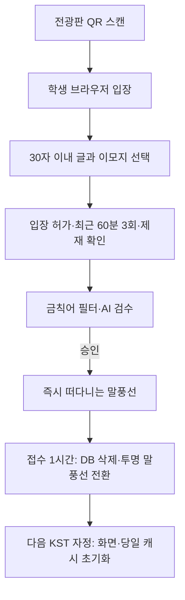

# 무드월 전체 흐름

승인된 글은 **바로 떠다니는 말풍선**이 된다. 별도 강조나 4개 자리 제한, 화면 자리를 기다리는 대기열은 없다. 서버 DB의 글은 접수 후 1시간에 삭제하지만, 전광판 노트북이 이미 받은 글은 **내용이 담긴 투명 말풍선으로 자정까지** 남긴다.

1. **QR로 접속한다.** QR은 5분마다 바뀌고 각 QR은 발급부터 10분 유효하다. 현재·직전 QR을 사용할 수 있지만 직전 QR 사용으로 만료 시각을 늘리지는 않는다. LTE·5G도 허용하므로 교외 접속 차단을 보장하지 않는다.
2. **글을 작성한다.** 30자 이내의 멘션과 배경 이모지를 고른다. 익명 브라우저 쿠키로 참여자를 구분하며, 의도적 쿠키 삭제까지 기기 한 대로 묶지는 못한다.
3. **접수 조건을 확인한다.** 최근 60분 기준 승인·검수 중 글은 최대 3회, 검수 중은 최대 1개, 새 접수 간격은 10초다. 현재 정지와 QR 입장 허가도 확인한다.
4. **검수한다.** 규칙 필터 뒤 AI 공개 적합성·감정 분류를 수행한다. 확정 금칙 위반은 당일 3회 경고·5회 정지다. AI의 부적절·불확실 판정은 수정 안내이며 자동 위반 가산에 사용하지 않는다.
5. **승인 즉시 공개한다.** DB 표시 상태를 FLOATING으로 확정해 전광판 조회에서 바로 제공한다. 전광판은 SSE 알림과 주기 조회로 승인 글을 받아 당일 브라우저 캐시에 합친다. 100개씩 나누어 전송하지만 모든 페이지를 읽으므로 표시 100개 제한이라는 뜻이 아니다.
6. **일반 말풍선으로 떠다닌다.** 각 글은 안정된 ID로 렌더하고 다시 조회했다고 입장 애니메이션을 반복하지 않는다. 별도의 강조 자리나 남은 강조 시간은 없다.
7. **접수 1시간에 투명해진다.** 서버는 원문 공급을 중단하고 작은 배치로 DB 제출 행을 삭제한다. 이미 받은 글은 브라우저에서 같은 내용의 투명 말풍선으로 전환한다. DB 목록에서 빠진 것을 말풍선 삭제 신호로 쓰지 않는다.
8. **자정에 비운다.** 다음 한국 시간 자정에 화면과 당일 캐시를 초기화한다. 운영자 숨김·기기 해지에는 해당 경계에 맞춰 미리 정리한다.

예를 들어 **13:00 접수 → 검수 승인 즉시 일반 말풍선 → 14:00 DB 삭제·투명 말풍선 → 자정에 말풍선 삭제**다. 23:50 접수 글은 자정에 화면과 당일 캐시를 비우고 00:50에 DB 삭제 대상이 된다. 중단·오프라인으로 DB 보관 시간을 연장하지 않는다.

노트북은 클라우드 전광판 웹페이지를 브라우저로 열고 케이블로 화면을 출력한다. 서버는 게시·검수·권한·DB를 맡고 브라우저는 움직임과 당일 캐시를 맡는다. 인증된 같은 브라우저는 새로고침 후 캐시를 복원할 수 있지만, 브라우저 저장소 삭제·다른 노트북으로 교체한 뒤 DB에서 지운 원문은 서버가 복구할 수 없다. 전광판 전체가 오프라인인 동안 접수 1시간을 넘긴 글도 전송을 보장할 수 없다.

페이지 수집은 매번 첫 페이지부터 `nextCursor=null`까지 순서대로 진행한다. 숨김·만료는 각 페이지에서 다시 검사하고, 손상·만료된 커서는 첫 페이지부터 재시작한다. 실제 React 전광판 화면·학교망·노트북의 지속 표시 시험은 [구현 상태](implementation-status.md)의 남은 수락 범위다. 세부 계약은 [HTTP 계약](backend-contracts.md), 현장 운영은 [노트북 안내](display-laptop.md)를 따른다.
